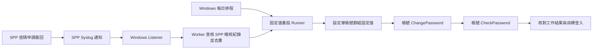
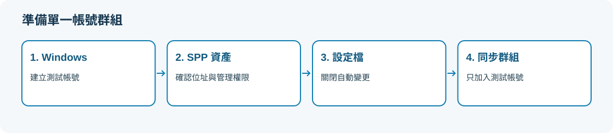
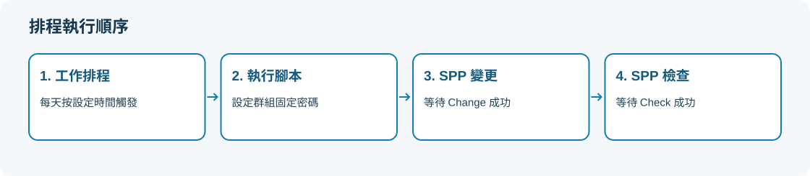
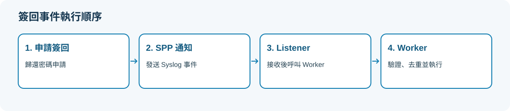

# KB-005：SPP 固定密碼重設與簽回後觸發

## 用途與適用範圍

特定系統要求帳號每次變更後仍使用同一組指定密碼時，本案例以專用的單帳號密碼同步群組設定固定值，再依序執行該帳號的 `ChangePassword`、`CheckPassword`。可由 Windows 每日排程觸發，或由密碼申請簽回事件經 Syslog、Listener、Worker 觸發。

使用者已在 AIX 客戶環境完成兩種方式，並在 SPP 9.0／Windows Server 2025 lab 驗證手動啟動排程、簽回自動觸發、變更與檢查成功，以及指定密碼可登入。AIX 的實際版本與客戶 SPP 版本未另行確認，不將 Windows 腳本直接視為 AIX 通用部署範本。**每日 03:00 自然到時執行尚待確認。**

這是「將密碼重設為指定固定值」，不是產生新密碼的輪替。固定值不會消除密碼先前被揭露的風險，應限核准的例外帳號，保留使用範圍、負責人與定期檢討紀錄。公開版增加預覽、參數檢查與失敗保護後，僅完成靜態及合成資料測試，尚未在實機重跑。

## 架構與驗證界線



本篇三張圖片均為**流程示意圖，不是實際操作截圖**。來源未提供可安全公開的產品畫面，不以示意圖當作驗收證據。Windows 執行主機負責排程、接收通知及呼叫 API；真正的目標帳號密碼變更由 SPP 執行。

## 一、部署前確認

| 項目 | 核對內容 |
|---|---|
| 執行平台 | Windows 與 PowerShell 7；認證檔依賴 Windows DPAPI，不能移到 Linux 使用 |
| SPP 認證 | 範例使用本機提供者的帳密 grant；必須是環境原已允許的驗證方式。不支援互動式 MFA／Entra ID 登入 |
| SPP 權限 | 執行帳號需可讀目標帳號、同步群組、設定檔、RunningTasks、密碼及存取稽核紀錄，並可設定群組密碼與執行帳號變更／檢查。通知設定另需管理 Syslog 與事件訂閱的權限 |
| 權限界線 | 以上為腳本所需操作，尚未查得此客製流程的最小內建角色組合；由管理者依現場 API 權限核對，不直接要求日常排程使用 Appliance Administrator |
| 網路 | 執行主機至 SPP HTTPS；SPP 至 Listener TCP 15514（可於設定調整）；SPP 至目標系統維持既有管理連線 |
| 憑證 | SPP HTTPS 名稱及信任鏈須有效，預設 `SkipCertificateCheck=false`，不以略過驗證作為正式部署方式 |
| 保護範圍 | 使用專用資料夾與專用執行帳號；腳本、設定、認證與 runtime 僅允許該帳號及必要管理者存取 |

One Identity 官方 API 教學說明，新安裝的 SPP 8.0 預設停用部分 OAuth grant。**若帳密 grant 被停用，不要為了套用範例而啟用它**；需另行設計環境允許的驗證方式，本套件不能直接套用。API v4 路徑來自來源案例，部署前應在當版 API 文件核對端點、欄位與權限；本次未連線設備查驗。參考 [官方 API 與驗證方式介紹](https://github.com/OneIdentity/safeguard-api-tutorial/blob/master/spp1-introduction/README.md)。

## 二、準備專用帳號與同步群組

1. 選定單一核准測試帳號，確認 SPP 已能管理它。目標系統的密碼長度、複雜度、歷程及最短使用期限須容許此固定值流程；不由腳本放寬主機安全原則。
2. 在 SPP 記錄 Asset ID、Account ID、資產位址及帳號名稱。Windows lab 使用本機帳號；AIX 案例另依其平台管理方式驗證。
3. 建立專用密碼設定檔，來源案例的 `ChangeSchedule.ScheduleType` 為 `Never`、`CheckSchedule.ResetPasswordOnMismatch` 為 `false`。不要修改共用設定檔來配合單一例外。
4. 建立專用密碼同步群組，**僅加入這一個帳號**，指派上述設定檔並記錄 Sync Group ID。Runner 會拒絕多成員群組、停用帳號與服務帳號。
5. 核對該帳號適用的存取要求原則，避免內建「簽回後變更密碼」與客製固定值流程同時觸發。調整前保存原設定，依核准範圍處理。



圖 1：準備流程示意。設定檔、群組成員與帳號身分均須在目標環境確認。

Runner 先設定群組密碼，再呼叫帳號的 `ChangePassword`，等待完成後才呼叫 `CheckPassword`。來源 lab 紀錄指出群組 `/Sync` 曾得到不同密碼，因此本範例不以 `/Sync` 取代此順序；這是案例觀察，不是所有版本的原廠行為保證。

## 三、準備設定與認證檔

將 [範例資料夾](../../examples/spp-fixed-password/README.md) 複製至執行主機的專用目錄，例如 `C:\SPP\FixedPassword`，不要直接在 Git checkout 產生認證檔。安裝程式會限制整個部署資料夾的 ACL，因此不得指向已有其他用途的資料夾。

複製 `config.example.json` 為 `config.json`，將 `<CUSTOMER_...>` 與 ID `0` 換成核准環境值。範例值不能直接執行。

| 設定欄位 | 填寫方式 |
|---|---|
| Appliance | SPP DNS 名稱或 IP，不含 `https://`、路徑或連接埠 |
| ListenAddress／Port | 執行主機的一個實際監聽 IP／TCP 連接埠；不使用全介面監聽位址 |
| AllowedSources | 實際送出 Syslog 的 SPP 節點 IP 陣列；不接受萬用來源或網段 |
| AccountId／AssetId／SyncGroupId | SPP 實際正整數 ID，不是顯示名稱 |
| ExpectedAddress／ExpectedAccountName | 與 SPP 帳號所屬資產位址及帳號名稱完全相符 |
| CredentialFile | SPP 認證檔路徑；預設 `spp-credential.xml` |
| ListenerTaskName／WorkerTaskName | 兩個不同的工作名稱，只使用英數、連字號與底線 |

在**同一台執行主機、使用排程將採用的 Windows 帳號**，以 PowerShell 7 建立認證檔。以下指令需由部署者在核准環境執行，輸入內容不會寫在命令列中：

```powershell
Set-Location C:\SPP\FixedPassword
Get-Credential -Message '輸入 SPP API 帳號' |
    Export-Clixml -LiteralPath .\spp-credential.xml -NoClobber -Confirm
Get-Credential -UserName 'fixed-password' -Message '輸入指定固定密碼；使用者名稱僅為標籤' |
    Export-Clixml -LiteralPath .\fixed-password.xml -NoClobber -Confirm
```

`fixed-password.xml` 的使用者名稱僅為標籤，密碼欄位才是固定值。Windows 上 `Export-Clixml` 使用 DPAPI，限定同一使用者、同一電腦解密；換主機或執行身分時須重新建立，不能複製後直接使用。同一身分的程序仍可解密，DPAPI 不能取代檔案 ACL。[Microsoft 認證匯出說明](https://learn.microsoft.com/en-us/powershell/module/microsoft.powershell.utility/export-clixml?view=powershell-7.5)。

兩份 XML、實際設定、執行狀態與日誌均不得提交 GitHub。不要在腳本、命令列、Transcript、截圖或錯誤回報中加入密碼與 Token。密碼必須短暫解密才能送入 HTTPS API；清除變數不代表程序記憶體已保證清零。

異動入口支援 `-WhatIf/-Confirm`，首次先預覽，再挑單一核准帳號實跑。`-WhatIf` 是不連線的整體動作預覽，不驗證 API 權限與主機連線；`-InspectOnly` 會登入 SPP 並讀取資訊，可能建立本機 runtime／鎖定檔，但不提交密碼工作。

## 四、設定每日 03:00 排程

先依設定核對目標身分；僅使用每日排程時不必初始化簽回事件基準：

```powershell
Set-Location C:\SPP\FixedPassword
$c = Get-Content .\config.json -Raw | ConvertFrom-Json
$target = @{
    Appliance = $c.Appliance
    AccountId = $c.AccountId
    SyncGroupId = $c.SyncGroupId
    ExpectedAddress = $c.ExpectedAddress
    ExpectedAccountName = $c.ExpectedAccountName
    CredentialFile = (Join-Path $PWD $c.CredentialFile)
}
.\SPP-Windows-TARGET_ACCOUNT-FixedPassword_v1.ps1 @target -WhatIf
.\SPP-Windows-TARGET_ACCOUNT-FixedPassword_v1.ps1 @target -InspectOnly
.\Install-DailyTask.ps1 -Time '03:00' -WhatIf
.\Install-DailyTask.ps1 -Time '03:00' -Confirm
```

`Install-DailyTask.ps1` 建立 `SPP-FixedPassword-Daily`，使用目前 Windows 帳號及 **Interactive** 登入模式，並禁止重疊執行；同名工作已存在時停止，不覆寫。這代表每日 03:00 該使用者仍須登入，主機須開機且未睡眠。需要登出仍執行的正式設計，必須另外核准排程身分與登入模式，不能把本範例當成無人值守已驗收。

在 Windows 工作排程器核對工作動作、身分、觸發時間與主機時區。挑核准的測試時段手動按「執行」，確認結果 `0`，再核對 SPP 兩筆工作與目標帳號登入。排程實際呼叫 Runner，會重設密碼；不要同時執行另一份 Runner。之後須另留存自然到時執行的時間、工作結果與 SPP 工作 ID。



圖 2：排程流程示意。每日時間只是觸發設定，不能替代自然到時執行證據。

## 五、設定簽回後觸發

此流程的 Listener 使用**未加密 TCP Syslog**。來源 IP 限制不是訊息身分驗證；Worker 還會向 SPP 查證簽回紀錄與帳號／資產 ID，才交給 Runner。若環境要求 TLS Syslog，本 Listener 不適用，不能只把 SPP 加密選項打開。請由管理者另行設計受保護傳輸；不要對外開放此監聽埠。

1. 在相同執行帳號的 PowerShell 7 核對目標，建立事件基準。初始化會將當時既有簽回標為已略過，僅做一次；不要刪除 runtime 重新初始化：

```powershell
.\Invoke-CheckinWorker.ps1 -InspectOnly
.\Invoke-CheckinWorker.ps1 -Initialize -WhatIf
.\Invoke-CheckinWorker.ps1 -Initialize -Confirm
```

2. 使用同一帳號以系統管理員開啟 PowerShell 7，預覽並安裝：

```powershell
.\Install-WindowsTasks.ps1 -WhatIf
.\Install-WindowsTasks.ps1 -Confirm
.\Get-DeploymentStatus.ps1
```

安裝時詢問的是 **Windows 排程帳號密碼**，不是 SPP 密碼或 Windows Hello PIN。安裝程式限制部署目錄 ACL、建立 Worker 與開機觸發的 Listener、建立指定 SPP 來源的防火牆規則，並啟動 Listener。兩個工作使用 **Password** 登入模式，與前節 Daily 的 Interactive 不同。防火牆由集中管理者控制時可使用 `-SkipFirewallConfiguration`，但須事先依核准程序完成規則；腳本不會代為確認集中原則。

3. Listener 應為 `Running`，`Blocked` 為 `False`。通知先預覽，再套用：

```powershell
.\Configure-SPPNotification.ps1
.\Configure-SPPNotification.ps1 -Apply -WhatIf
.\Configure-SPPNotification.ps1 -Apply -Confirm
```

預覽模式會登入 SPP 讀取設定。實際模式建立 TCP／OctetCounting／JSON、空白 KeyPrefix 的 `AccessRequestCheckedIn` 訂閱；相同名稱但內容不同時停止，不覆寫。通知管理帳號可由 `-Credential (Get-Credential)` 於核准現場另行提供，不必將該高權限認證保存在日常 Worker 檔案。

4. 對單一測試帳號申請密碼、取得後簽回。查 Listener／Worker 結果、SPP 變更與檢查工作，再以核准方式確認指定密碼可登入。



圖 3：簽回流程示意。Listener 僅接收指定來源，Worker 查證 SPP 稽核事件，並用事件狀態避免重複執行。

Listener 啟動時會建立一次補查項目，補查基準之後的事件；平時每十秒檢查的是本機佇列，不是持續輪詢 SPP。帳號忙碌時先保留佇列；失敗時停止自動重試。不同 Windows 工作階段透過部署資料夾的檔案鎖避免本套件重疊執行，但不能阻止其他管理者或其他主機同時操作 SPP，部署時仍須排除其他密碼變更來源。

## 六、驗證與故障處理

| 檢查點 | 驗收方式 |
|---|---|
| Daily | 手動執行結果 `0`；自然 03:00 執行另查時間、結果與對應 SPP 工作 |
| Listener | 持續 Running、指定 IP／埠監聽，且能收到符合條件的通知 |
| Worker | 工作完成後 LastResult 為 `0`、Blocked 為 False、Queued 為 `0`，並能對應同一簽回事件 |
| SPP | 同一帳號的 ChangePassword、CheckPassword 最終狀態均為 Success；HTTP 202 不是完成 |
| 目標帳號 | 指定密碼可登入；帳號身分、目標主機與核准測試一致，不保存密碼本身 |

`Get-DeploymentStatus.ps1` 顯示 Listener、Worker 與事件佇列，不包含 Daily。常駐工作仍在 Running 時不要求結果為 `0`；避免只靠單一數字判斷成功。

| 現象 | 處理方向 |
|---|---|
| 認證 XML 無法解密 | 核對同機器、同 Windows 身分；不可改存明文解決 |
| 每日排程沒有執行 | 核對 Interactive 登入、主機電源／睡眠、時區與工作歷程；手動成功不等於自然觸發成功 |
| 收不到通知 | 核對 Listener、指定監聽 IP、SPP 實際來源、TCP／OctetCounting／JSON／空 KeyPrefix 與既有網路規則 |
| 通知被拒絕 | 查看本機 rejected 與 SPP 稽核紀錄；不要直接將事件改成已驗證或放寬來源 |
| Blocked 為 True／密碼工作逾時 | 保留狀態及工作 ID，先在 SPP 查明結果；禁止刪除狀態後盲目重跑 |
| SPP 工作成功但登入不符 | 核對實際目標身分、其他變更來源與目標密碼政策，不能以 API 成功取代登入驗證 |

Runner 在群組密碼寫入**之前**保存 `runtime/password-operation.json`，記錄階段與工作 ID，不保存新舊密碼；完成時標為 Completed，下一次執行保存前一份紀錄。中斷或結果不明時會拒絕後續實跑。Worker 另保存 `checkin-state.json`、`blocked.json`、佇列及去識別錯誤分類。安裝與通知設定亦留下異動前後的非秘密紀錄，限受控環境保存，不得上傳。

`Resume-UnsubmittedCheckin.ps1` 僅適用可證明沒有提交密碼工作、也沒有未解決群組密碼寫入的事件。預設只檢查，`-Apply -WhatIf` 預覽整體動作；實際解除必須經人工核准並以 `-Apply -Confirm` 執行。若工作已提交、群組寫入結果不明或紀錄不完整，須由管理者比對 SPP 與目標帳號後個別處理，本套件不提供自動回復。**沒有工作 ID 不代表沒有異動。**

## 七、停用與回復

先由核准管理者停止新觸發：停用本次 Daily／Listener 工作及指定的 SPP 事件訂閱，確認 Worker 與 SPP 工作均已結束。保存部署紀錄、佇列及狀態，不中止進行中的密碼工作。只針對本次建立且確認無其他用途的工作、訂閱與防火牆規則進行移除；既有資源不得一併清除。

設定檔、存取原則與資料夾 ACL 依變更前備份回復；安裝前的部署目錄 SDDL 位於本機 `runtime/installation-before.json`。本套件不保存原密碼，**沒有自動密碼回復功能**，不要自行將舊值寫回；如需恢復密碼管理方式，另依核准程序在 SPP 與目標帳號同步處理。

## 驗證紀錄

| 證據來源 | 已確認內容 | 限制 |
|---|---|---|
| 使用者 AIX 客戶案例 | 排程與簽回 Syslog 兩種方式已成功 | 未取得可公開的現場畫面、完整版本及日誌 |
| 使用者 SPP 9.0／Windows Server 2025 lab | 手動啟動排程、簽回觸發、ChangePassword／CheckPassword、指定密碼登入成功 | 是固定值重設；03:00 自然到時執行尚未確認 |
| 公開版檔案檢查 | PowerShell 語法、純函式合成測試、示意圖與文件連結、差異及敏感資訊掃描 | 未建立真實認證、未安裝工作或防火牆、未連 SPP／AIX／Windows 目標；不代表整合驗收 |

[範例腳本與檔案說明](../../examples/spp-fixed-password/README.md) · [返回 KB 目錄](README.md)
