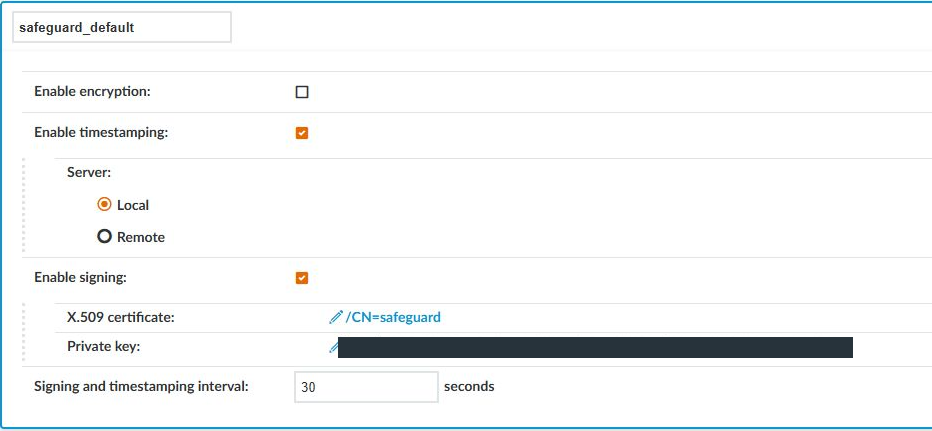
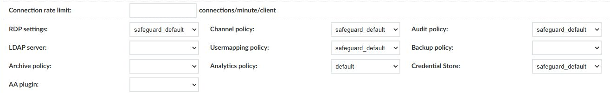
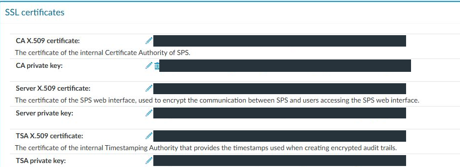
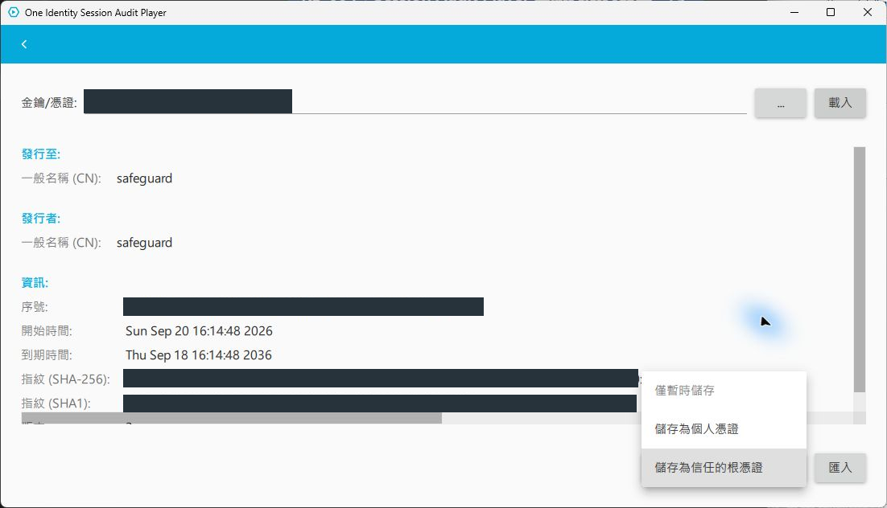

# KB-004：Session Audit Player 回放失敗與簽章、時間戳記顯示 X

## 問題與適用範圍

環境為 SPS 9.0.0、SPP 9.0，用戶端為 Windows 上的 One Identity Session Audit Player（舊稱 Safeguard Desktop Player）。從 SPP 活動中心啟動側錄回放時，依序遇到三個現象：側錄下載不下來、跳出 SSL 憑證錯誤、可以播放但「簽章」「時間戳記」顯示 X。應分別檢查名稱解析、HTTPS 信任與側錄驗證，不把三者視為同一問題。

本文保留來源文件的單一實驗環境紀錄，歷史錯誤未附原始日誌，亦未獨立重現；不代表客戶正式環境驗收。Player 完整版本未記錄，匯入介面須依現場版本確認。下文以 `<CUSTOMER_SPP_FQDN>`、`<CUSTOMER_SPS_FQDN>` 代表環境值，憑證指紋與序號因環境而異，不列出實驗值。

## 現象一：Player 找不到 SPP 主機

Player 左側「警告」分頁出現 `ZatStreamer: network error, trying to retry; error_code='QNetworkReply::HostNotFoundError'`，`retry_count` 由 0 到 2 皆失敗。中文 Windows 上 `error_message` 會顯示亂碼，可能與字元編碼有關；判讀以 HostNotFoundError 為準，不依亂碼推定原文。接著出現 `Unknown audit source type; ... magic=''`，畫面上縮圖、簽章、時間戳記全部空白。

原因是執行 Player 的電腦無法解析 SPP 的 FQDN，常見於未連 VPN、使用外部 DNS，或該名稱只登記在內部 DNS。在該電腦執行 `Resolve-DnsName <CUSTOMER_SPP_FQDN>`；解析得到但仍失敗時，再執行 `Test-NetConnection <CUSTOMER_SPP_FQDN> -Port 443` 確認連線。

本次觀察與推論：cache 目錄中的 `.zat` 檔只有約 0.1 kB，判斷是從 SPP 下載的串流指引檔，不是側錄本體；串流失敗後 Player 讀這個空殼，才出現 `magic=''` 的錯誤。後續錯誤可能是下載失敗的連帶結果；修復連線後若仍出現，須另查檔案格式與完整性。官方沒有逐行說明這些訊息。

## 現象二：無法驗證 SSL 憑證

DNS 正常後，Player 下載側錄時跳出「憑證錯誤：無法驗證 SSL 憑證」。對話框中 Subject 與 Issuer 皆為 SPP 的 FQDN，O／OU 為 Safeguard、L 為 Lindon、ST 為 UT，來源紀錄判斷為預設自簽網頁憑證；Subject 與 Issuer 相同本身不足以證明來源，仍須比對設備匯出憑證與簽章。

官方 KB 4256487（舊編號 288670）記載舊版 Player 以叢集成員 IP 回放時，HTTPS 憑證的 SAN 必須包含這些 IP。該 KB 適用較舊版本，現場應核對 Player 實際連線的名稱或 IP、SAN、憑證有效期及完整信任鏈，不能只匯入根憑證而忽略名稱不符。

本次觀察：實驗環境按「繼續」仍可完成播放，但不能據此當成交付做法。正式環境應將 SPP 網頁憑證換成企業 CA 簽發的憑證；實驗環境可將 SPP 自簽憑證以下文相同的方式匯入為信任的根憑證。

## 現象三：簽章與時間戳記顯示 X

### 判讀

依官方 Player 指南，開啟側錄時會自動驗證，簽章狀態分為「已簽章且有效」「無法驗證簽章」「未簽章」，時間戳記另有「無法驗證」狀態。X 只表示沒有通過，要看「警告」分頁才知道是哪一種。

本次警告分頁只有一行：`adp.core` 回報 `The certificate could not be verified; fingerprint='<SHA-1>'`。這表示某張憑證未通過驗證，單憑此行不能判定是簽章或時間戳記憑證，也不能證明簽章有效。將該 SHA-1 指紋與候選憑證比對，就能知道缺的是哪一張。

### SPS 端設定確認

來源紀錄列出以下 SPS 9.0 設定；排錯時須核對實際使用的原則：

在 **Policies > Audit Policies** 開啟連線所用的稽核原則，本例為 `safeguard_default`，已勾選 Enable timestamping（Server：Local）與 Enable signing（指定 X.509 憑證與私鑰），Signing and timestamping interval 為 30 秒。在 **Traffic Controls > RDP > Connections** 展開 SPP 使用的連線原則，本例為 `safeguard_rdp`，確認 Audit policy 欄位選的是上述原則，而不是未啟用簽章的 `default`。

圖 1：safeguard_default 已啟用 Local 時間戳記及簽章，間隔為 30 秒。此圖確認原則設定，不代表某一筆側錄已驗證成功。

圖 2：RDP 連線的 Audit policy 選用 safeguard_default；不要與相鄰的 Channel policy 或 RDP settings 混淆。

依官方文件，稽核原則包含加密、時間戳記與簽章設定；未使用自訂原則時，修改預設原則會影響所有使用它的稽核通道。正式環境建議另建原則再指派給需要的連線。

本次觀察與推論：原則變更只影響之後建立的工作階段。測試時應開一條新連線、結束後再回放，不要以標示「即時」、仍在進行中的工作階段判斷結果。

### Player 端匯入根憑證

依官方 Player 指南，驗證簽章時，簽發簽章憑證的 CA 憑證必須存在於執行 Player 的主機；驗證時間戳記時，需要 SPS 的 CA 憑證。本例使用 Local 時間戳記服務，須分別確認簽章與 TSA 的信任鏈；兩者可能共用 CA，不一定是兩張不同的根憑證。使用外部 TSA 時，須改核對該 TSA 的實際簽發鏈。

第一張是簽章憑證的簽發者。在 Audit Policy 點選 X.509 certificate 連結檢視其 Issuer；本例的簽章憑證是自簽（Subject 與 Issuer 皆為 `CN=safeguard`，Basic Constraints 為 CA:TRUE），本身即根憑證，直接匯出這張即可。若由企業 CA 簽發，須備妥所需根與中繼 CA 憑證，確認整條鏈可驗證。驗證用途只需公開憑證，不匯出簽章或 TSA 私鑰。

第二張是 SPS CA。位置在 **Basic Settings > Management > SSL certificates** 的 CA X.509 certificate，例如 `CN=<CUSTOMER_SPS_FQDN> root CA`。同一區塊的 TSA X.509 certificate 由它簽發，內建時間戳記服務使用的就是 TSA 憑證，所以匯入 CA 即可，不必匯入 TSA 憑證本身。下載時點選憑證連結，不要下載 CA private key。

圖 3：Management 的 SSL certificates 區分 CA、Server 與 TSA 憑證。Local 時間戳記驗證須核對 CA X.509 certificate；不要下載 private key。環境識別資訊已遮蔽。

以下匯入條件參考 SPS 7.0.2 LTS Player 指南，現場 Player 版本仍須核對：憑證檔採 PEM 格式，先複製到用戶端本機資料夾，不直接從網路共用匯入。

匯入方式：在 Player 右上齒輪進入金鑰／憑證畫面，選擇憑證檔後按「載入」，核對 Subject、Issuer 與指紋，再從下拉選單選「儲存為信任的根憑證」，按「匯入」。「僅暫時儲存」在關閉 Player 後即失效；「儲存為個人憑證」用於解密加密側錄，都不適用於此情境。

圖 4：Player 載入公開憑證後可核對發行至、發行者與指紋，再選擇「儲存為信任的根憑證」。圖中僅展開選項，尚未按「匯入」；深色區塊為已遮蔽的路徑、序號及指紋。

多台稽核人員電腦時，可改以 GPO 將憑證派送至本機電腦的「受信任的根憑證授權單位」。官方 Player 指南記載 Windows 上會從 Local Computer > Trusted Root Certification Authorities 取得憑證。

### 本次排除順序

只匯入簽章憑證時，重新開啟已結束的工作階段，簽章與時間戳記仍為 X，警告分頁出現上述指紋訊息，且指紋與已匯入的簽章憑證不符。再匯入 SPS CA 後，開一條新連線並於結束後回放，下游、上游、簽章、時間戳記四項皆為綠勾，警告分頁不再出現憑證訊息。因兩張都已匯入，本次無法單獨證明簽章憑證是否必要；本文依兩種用途列出信任需求，不把本例的憑證數量當成通用要求。

## 安全考量

本例的簽章憑證是自簽且 CA:TRUE。匯入為信任的根憑證後，使用該信任存放區的驗證可能接受它簽發的其他憑證，仍受用途、有效期及鏈驗證限制，信任範圍不限於稽核軌跡。實驗環境也須先核准信任範圍；正式環境建議簽章憑證與 SPP 網頁憑證都改由客戶企業 CA 簽發，這兩種用途可沿用客戶 PKI 的信任鏈；Local TSA 仍須另核對 SPS CA，不因更換網頁憑證而自動改變。

交付前置作業應列出稽核人員電腦需信任的憑證：簽章憑證的簽發 CA、SPS CA、SPP 網頁憑證鏈，並註明派送方式與到期日。

## 驗證與回復

驗收以已結束的新工作階段為準：四項狀態皆為綠勾，警告分頁沒有 `The certificate could not be verified` 訊息，並記錄 SPS、SPP 與 Player 版本。

回復前記錄匯入前後的存放區、Subject、指紋及派送方式。官方舊版指南記載 Windows 可保存至 Windows 憑證存放區，並從 Local Computer 的 Trusted Root Certification Authorities 讀取驗證憑證；不可據此猜測現場 Player 的實際寫入位置。只移除本次新增、已確認無其他用途的信任項目；GPO 派送者由原 GPO 回復。若無法定位，先查該 Player 版本文件或洽原廠，不刪除 Player 設定資料夾。

## 來源與相關文件

以下舊版官方指南作為驗證機制參考；SPS 9.0 的畫面設定來自案例紀錄，不代表已確認所有新版行為。

- [官方：SPS 稽核原則，時間戳記與簽章設定](https://support.oneidentity.com/technical-documents/doc1494406)
- [官方：Player 回放驗證與憑證需求](https://support.oneidentity.com/technical-documents/doc1746987)
- [官方 KB 4256487（舊編號 288670）：HTTPS 憑證 SAN 與叢集 IP](https://support.oneidentity.com/kb/4256487/error-unable-to-verify-ssl-certificate-to-resolve-this-issue-import-the-appropriate-certificates-including-the-root-ca)
- [官方 SPS 7.0.2 LTS Player 指南：憑證需求與匯入](https://support.oneidentity.com/technical-documents/doc1951466?hash=keyboardlayout)
- [官方 SPS 7.5.1 Player 指南：驗證狀態](https://support.oneidentity.com/technical-documents/one-identity-safeguard-for-privileged-sessions/7.5.1/safeguard-desktop-player-user-guide/4)
- [Windows 安裝 Safeguard Desktop Player 與回放](../sop/desktop-player-install.md)
- [KB 目錄](README.md)
