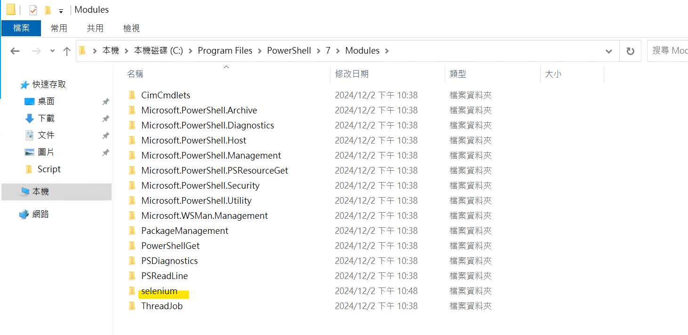
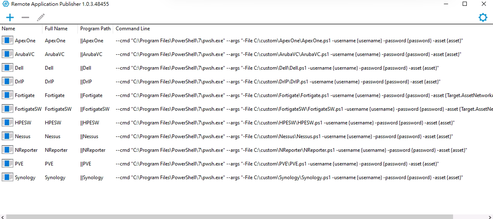
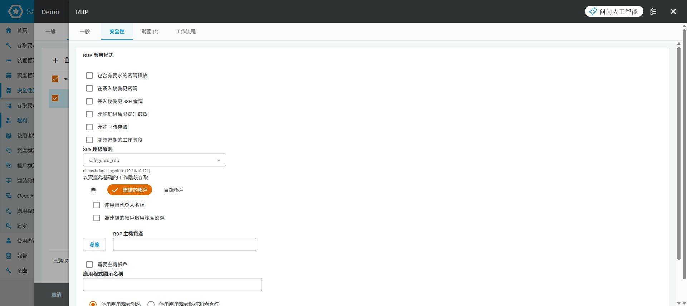
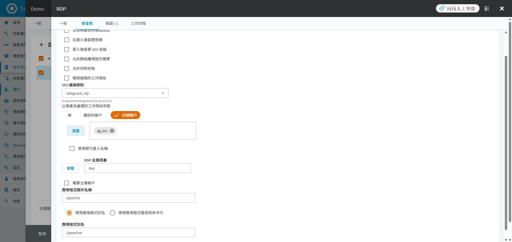
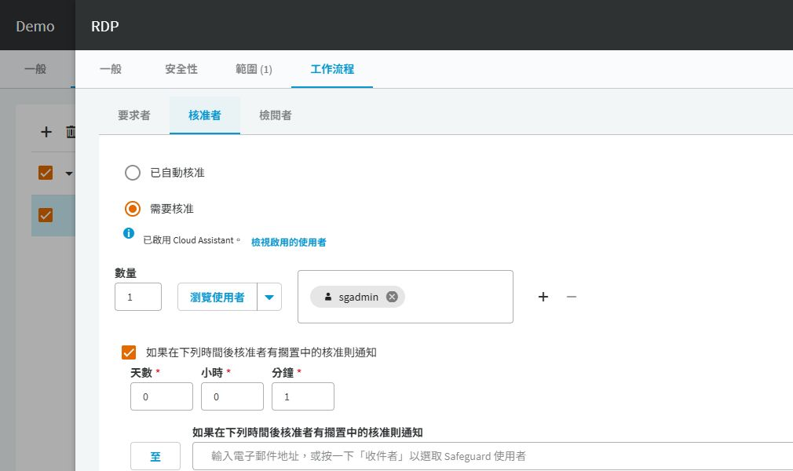

# SPP／SPS 遠端應用程式發佈整合

## 目的

讓使用者經 SPP 申請與核准，由 SPS 代理到 Windows 應用程式發佈主機，再開啟指定工具或執行 PowerShell Selenium 代登。瀏覽器自動化統一使用 **Chrome for Testing（CfT）**，搭配同一發布版本的 ChromeDriver，並以 PowerShell 7 執行。本文以 ApexOne 示範如何串接發佈別名、PS1 與 SPP 原則；其他應用程式依各自腳本與登入流程調整。

## 適用範圍

適用於由 SPP 管理申請與核准、SPS 代理及側錄，並由 Windows／RDS 發佈主機執行 RemoteApp Launcher、PowerShell 7 與 Chrome for Testing 的部署。本文 SPP／SPS 畫面版本分別為 9.0.0.2807、9.0.0；引用的 8.0 LTS 官方設定須依現場版本確認，不代表 9.0 全功能相容性已驗證。

發佈工具、模組目錄與 Chrome for Testing 排錯案例來自不同部署，不能視為同一環境的完整驗收紀錄。SPP 表單為設定示範，SPS 畫面僅供核對既有原則；Launcher／RDS 安裝、原則實際套用、應用程式代登、側錄回放及多人使用仍須在目標環境逐項驗收。

## 前置條件

先確認 SPP／SPS 已整合、Windows 發佈主機可由 SPS 連線，且能存取目標應用程式。RDS CAL、授權伺服器及應用程式授權須按實際部署確認；Windows Server 管理用遠端連線不能替代 RDS 發佈所需授權。[Microsoft RDS CAL 說明](https://learn.microsoft.com/en-us/windows-server/remote/remote-desktop-services/rds-client-access-license)。

| 要確認的物件 | 範例或記錄內容 | 與其他物件的關係 |
|---|---|---|
| 發佈主機 | `<CUSTOMER_RDS_HOST>` | 執行 Launcher、PowerShell、Chrome for Testing 與 PS1 的 Windows 主機 |
| 主機登入帳戶 | `<CUSTOMER_RDS_ACCOUNT>` | 登入 Windows 工作階段；不同於目標網站帳戶 |
| 目標應用程式 | `<CUSTOMER_APP_HOST>` | ApexOne 等管理網站，供 PS1 的 asset 參數使用 |
| 應用程式帳戶 | `<CUSTOMER_APP_ACCOUNT>` | 輸入目標網站的帳戶，須納入 SPP 的申請範圍 |
| 發佈別名 | `\|\|ApexOne` | SPP 必須指向發佈主機上實際存在的別名 |
| 腳本 | `C:\custom\ApexOne\ApexOne.ps1` | 此路徑存在於發佈主機，不是使用者電腦或 SPS |
| SPS Connection／Channel Policy | 各自記錄名稱 | Connection 必須引用允許 RemoteApp 的 Channel Policy |

上表別名中的兩個直線字元是原始別名語法，並非檔案路徑。實際帳密不得填進文件、Git 或命令列截圖。

## 操作步驟

### 1. 先分清楚三段連線


SPP 管申請與認證，SPS 代理工作階段，PS1 在 Windows 發佈主機內操作應用程式。網站代登失敗不一定是 SPS 問題；應依「RDP 是否建立、程式是否啟動、網站是否登入」逐段判斷。

### 2. 準備發佈主機與 Selenium 元件

#### 發佈主機的 RemoteApp 登錄與群組原則

以下設定作用於 **Windows 應用程式發佈主機 `<CUSTOMER_RDS_HOST>`**，不是 SPP、SPS 或使用者的電腦。先記錄 Windows／RDS 與 Publisher 版本，確認主機由哪個 GPO 管理，再於核准的變更範圍內套用。

登錄位置為 `HKEY_LOCAL_MACHINE\SOFTWARE\Policies\Microsoft\Windows NT\Terminal Services`。兩個值都使用 **DWORD（32 位元）**，即使作業系統為 64 位元也相同。

| 值名稱 | 本案例設定 | 用途與限制 |
|---|---|---|
| `fAllowUnlistedRemotePrograms` | `1` | 允許清單外遠端程式。本案例截圖採用；實際套用前須取得核准。不是所有 RemoteApp 部署的必要條件或安全預設。 |
| `fEnableRemoteFXAdvancedRemoteApp` | `0` | 停用 RemoteApp 進階圖形功能，依 One Identity Launcher 教學配置；不等於停用 RemoteFX vGPU。 |

One Identity 的 [Launcher 設定教學](https://github.com/OneIdentity/SafeguardAutomation/blob/master/RDP%20Applications/Tutorial/README.md)指定第二個值為 `0`。Microsoft 對應原則為 **Computer Configuration > Administrative Templates > Windows Components > Remote Desktop Services > Remote Desktop Session Host > Remote Session Environment > Use advanced RemoteFX graphics for RemoteApp**，設為 **Disabled**。[Microsoft 原則說明](https://learn.microsoft.com/en-us/windows/client-management/mdm/policy-csp-admx-terminalserver#ts_server_advanced_remotefx_remoteapp)。該 CSP 頁面的 Windows 用戶端適用表不能當成 Windows Server 最早支援版本；Server 環境仍須核對實際 ADMX 與有效原則。本節不構成 SPS 9.0 全功能相容性驗收。

變更前在登錄編輯程式匯出上述機碼，並另記錄兩個值的原始類型、數值或「原本不存在」。機碼不存在時也要記錄，不能以空白截圖代替備份。若由網域 GPO 控管，先備份並修訂具權威性的 GPO，再確認套用結果；不要持續以本機值對抗 GPO。[Microsoft 群組原則處理順序](https://learn.microsoft.com/en-us/windows-server/identity/ad-ds/manage/group-policy/group-policy-processing)。

獲准採用本案例設定時，由管理者在指定機碼建立或修改上述 DWORD；只處理這兩個值，保留其他設定。清單外程式的開放須搭配專用發佈主機、最小登入權限、核准程式執行限制及目的地存取限制，並驗證使用者不能藉檔案對話框或子程序啟動未核准工具。

以下為在發佈主機執行的唯讀核對，適用 PowerShell 7。記錄登錄編輯程式顯示的型別，並保存這兩個值的查詢結果；查無值不等於已設為 `0`。

```powershell
#requires -Version 7.0
$remoteAppPolicyKey = 'HKLM:\SOFTWARE\Policies\Microsoft\Windows NT\Terminal Services'
if (Test-Path -LiteralPath $remoteAppPolicyKey) {
    Get-ItemProperty -LiteralPath $remoteAppPolicyKey |
        Select-Object fAllowUnlistedRemotePrograms, fEnableRemoteFXAdvancedRemoteApp
} else {
    Write-Output 'Terminal Services policy key does not exist.'
}
```

透過新的核准測試工作階段驗證，不為了補圖或測試而停止正式 RDS 連線。若需回復，將既有值還原原類型與數值；原本不存在者只移除本次新增的值，不刪除整個 Terminal Services 機碼。直接匯入 `.reg` 備份不會自動刪除後來新增的值，必須依變更紀錄核對；GPO 管理者則從原 GPO 回復並確認有效結果。


圖 1：登錄位置與兩個 DWORD 的用途說明。這是設定說明圖；適用版本與限制依本節官方資料核對，不能當成實機驗收結果。


圖 2：登錄編輯程式顯示 `fAllowUnlistedRemotePrograms` 為 REG_DWORD `1`，`fEnableRemoteFXAdvancedRemoteApp` 為 REG_DWORD `0`，位置與上表一致。此圖僅呈現登錄值，不代表有效 GPO 或應用程式代登已驗證成功。

#### Launcher 與 Selenium 元件準備

先依目標版本完成 RemoteApp Launcher 安裝與 RDS 發佈配置。8.0 LTS 官方整合使用 OISGRemoteAppLauncher，再由其命令列指定實際工具；Publisher 畫面列出的業務名稱不能代替檢查其背後 Launcher 設定。[官方 Remote Desktop Application 整合](https://support.oneidentity.com/technical-documents/one-identity-safeguard-for-privileged-passwords/8.0%20lts/administration-guide/18)。目前沒有 Launcher 安裝精靈與 RDS 發佈精靈的實機圖，這兩段仍需現場確認。

取得 [已保存元件](../../examples/custom-app-login/README.md)，大型套件以 Git LFS 下載。來源是 PowerShell 7.4.6 x64 與 PowerShell Selenium 4.0.0-preview3；它們是歷史案例版本，正式部署另依支援及安全維護要求選版。**現行自動化標準為 Chrome for Testing，不使用 Chrome Dev 或一般 Chrome 作為固定版本的自動化瀏覽器。** 瀏覽器套件未包含在此目錄，需另由 Google 官方取得；相關 KB 的 Chrome Dev 描述屬舊案例背景，以本節為現行部署基準。



圖 3：原環境將 selenium 放在 `C:\Program Files\PowerShell\7\Modules`。須用實際 RemoteApp 執行帳戶確認模組可讀取，不能只在管理員自己的使用者模組目錄安裝。


圖 4：本專案以圖中的模組目錄作為主要部署方式，將相容的 `chromedriver.exe` 放在 `C:\Program Files\PowerShell\7\Modules\selenium\assemblies`。圖中檔案總管隱藏副檔名，顯示的 chromedriver 即該執行檔。若模組另有版本子目錄，應以實際載入模組的 `ModuleBase\assemblies` 為準，不更新另一份未載入模組。下方範例以 `-WebDriverPath` 明確指向此資料夾。

版本相容是必要條件；還須確認真正啟動的是哪個 Chrome 執行檔。[Google 官方版本配對說明](https://developer.chrome.com/docs/chromedriver/downloads/version-selection)。更換前備份原 driver，記錄新舊版本、來源與 SHA-256；模組更新、重裝或重新解壓縮可能覆蓋手動放入的 driver，或改變載入目錄，完成後須重新核對及測試。來源 ZIP 的 driver 與附帶 sha256 不一致，詳見 [KB-003 的套件核對](../kb/custom-app-login-selenium.md)，不能直接以舊雜湊驗收。只替換經核對的 driver，不任意覆蓋 WebDriver.dll 等模組相依檔案。

將 ApexOne.ps1 放到前置表格指定路徑。先以專用測試帳戶驗證模組、網路及目標登入頁；確認可開啟頁面與找到欄位，再進行完整代登。此階段不把正式密碼寫進 PS1 或測試紀錄。

#### 2.1 Chrome for Testing 的部署與版本原則

Chrome Dev／一般 Chrome 的更新會讓自動化環境版本改變；把測試檔案放進既有 Chrome 安裝目錄，也會增加安裝與更新維護互相干擾的風險。本案曾遇到更新或覆蓋問題，但沒有完整更新程序證據，不推論所有 Dev 安裝都會被一般版覆蓋。

Google 提供的 CfT 專供測試且不自動更新，適合固定版本的自動化。一般使用者的瀏覽器維持原本更新管理，不以停用全機 Chrome 更新服務解決自動化問題。[Google Chrome for Testing 說明](https://developer.chrome.com/docs/automation-and-testing/chrome-for-testing)。

從 [CfT 官方下載頁](https://googlechromelabs.github.io/chrome-for-testing/)選定核准版本與 Windows 平台，取得 **同一發布版本**的 Chrome 與 ChromeDriver。解壓縮時保留 Chrome 完整相依檔案，不只複製 chrome.exe；完成後核對：

```text
C:\Automation\chrome\chrome.exe
C:\Program Files\PowerShell\7\Modules\selenium\assemblies\chromedriver.exe
```

Chrome 瀏覽器本體保留在 `C:\Automation\chrome`，不放入 `C:\Program Files\Google\Chrome\Application`，避免與既有 Chrome 共用檔案；ChromeDriver 則依圖 4 放入 Selenium 模組的 assemblies。程式與模組目錄由管理者維護，RemoteApp 帳號只授予讀取與執行，日誌另放可寫入位置。CfT 不自動更新仍須安排瀏覽器與 driver 成套升級、回歸測試與回復版本，不能永久停留在舊版。

#### 2.2 PATH 與實際執行身分

PATH 填的是**包含執行檔的資料夾**，不是執行檔本身：

| 設定 | 正確值 | 常見錯誤 |
|---|---|---|
| Chrome PATH | `C:\Automation\chrome` | 填成 `...\chrome.exe`，或多一層不存在的 `...\chrome\chrome` |
| ChromeDriver 位置 | 實際載入模組的 `ModuleBase\assemblies`，圖 4 為 `C:\Program Files\PowerShell\7\Modules\selenium\assemblies` | 更新錯誤的模組副本，或把 `-WebDriverPath` 填成 EXE 完整路徑 |
| 解壓縮層級 | chrome.exe 直接位於標準目錄 | 實際藏在 chrome-win64 子目錄，PATH 卻指向上層 |

User PATH 僅屬於該 Windows 帳號；Machine PATH 為全機設定。程序取得的是啟動時繼承的環境，修改系統設定不會自動刷新既有 RDS 工作階段。[Microsoft 環境變數範圍與繼承](https://learn.microsoft.com/powershell/module/microsoft.powershell.core/about/about_environment_variables)。

本案 `<CUSTOMER_TEST_USER>` 的互動測試成功，RemoteApp 卻以 `<CUSTOMER_REMOTEAPP_USER>` 執行，無法使用前者的 User PATH，出現 `cannot find Chrome binary`。改用 Machine PATH 並重新取得環境後，使用者回報成功。**測試與驗收都須以實際 RemoteApp 帳號進行，不能只看管理員視窗的結果。**

本標準透過 `-WebDriverPath` 指定模組 assemblies，**不要求把 ChromeDriver 加入 PATH**；`-BinaryPath` 已指定瀏覽器時，也不依賴 Chrome PATH。以下僅供仍需以名稱尋找 Chrome 的既有腳本使用，適用 PowerShell 7，存為 `C:\Automation\Set-AutomationPath.ps1`，以系統管理員執行。它保留原 PATH 順序，僅補上 Chrome 瀏覽器目錄，並記錄異動前後值；Machine PATH 會影響其他帳號的新程序，先 `-WhatIf`，再 `-Confirm` 套用。

```powershell
#requires -Version 7.0
#requires -RunAsAdministrator
[CmdletBinding(SupportsShouldProcess, ConfirmImpact='High')]
param()
$ErrorActionPreference = 'Stop'
$dirs = @('C:\Automation\chrome')
$files = @('chrome.exe')
for ($i = 0; $i -lt $dirs.Count; $i++) {
    if (-not (Test-Path (Join-Path $dirs[$i] $files[$i]))) {
        throw "Missing executable in $($dirs[$i])"
    }
}
$before = [Environment]::GetEnvironmentVariable('Path','Machine')
$parts = @($before -split ';' | Where-Object { $_.Trim() })
$normalized = @($parts | ForEach-Object {
    $_.Trim().TrimEnd('\')
})
$add = @($dirs | Where-Object { $_ -notin $normalized })
if ($add.Count -eq 0) { Write-Output 'No change required'; return }
$after = (@($parts) + @($add)) -join ';'
Write-Output "Before: $before"
Write-Output "After:  $after"
if ($PSCmdlet.ShouldProcess('Machine PATH','Append automation folders')) {
    $audit = Join-Path $PSScriptRoot (
        'PathChange-{0}.csv' -f (Get-Date -Format 'yyyyMMdd-HHmmssfff'))
    $record = [pscustomobject]@{
        Time = (Get-Date).ToString('o'); Before = $before
        Proposed = $after; Actual = $before; Status = 'Prepared'
    }
    $record | Export-Csv $audit -NoTypeInformation -Encoding utf8
    [Environment]::SetEnvironmentVariable('Path',$after,'Machine')
    $record.Actual = [Environment]::GetEnvironmentVariable('Path','Machine')
    $record.Status = 'Applied'
    $record | Export-Csv $audit -NoTypeInformation -Encoding utf8
    Write-Output "Audit: $audit"
}
```

```powershell
& 'C:\Automation\Set-AutomationPath.ps1' -WhatIf
& 'C:\Automation\Set-AutomationPath.ps1' -Confirm
```

確認沒有進行中的工作，再登出並重建實際帳號的 RDS 工作階段。若只重啟子程序，其父程序仍可能帶著舊 PATH。若需回復，依 CSV 的 Before 值比對現況後還原本次新增項目，避免覆蓋後續合法變更。

#### 2.3 PowerShell 7 與模組相容性

腳本開頭加上 `#requires -Version 7.0`，Launcher 明確使用 `pwsh.exe`。Windows PowerShell 5.1／ISE 使用 .NET Framework，PowerShell 7 使用現代 .NET；ISE 不會因安裝 PowerShell 7 而切換引擎。`#requires` 只限制最低版本，不會自動啟動 PowerShell 7。[Microsoft 移轉說明](https://learn.microsoft.com/powershell/scripting/install/migrating-from-windows-powershell-51-to-powershell-7)、[Requires 說明](https://learn.microsoft.com/powershell/module/microsoft.powershell.core/about/about_requires?view=powershell-7.4)。

本案在 Windows PowerShell 5.1 載入 WebDriver.dll 失敗，在 PowerShell 7 成功；日誌記錄 PowerShell 7.4.17，命令輸出顯示 Selenium 4.0.0。這是本案觀察，不是所有 Selenium 套件均不支援 5.1 的原廠聲明，也不是現行版本建議。模組顯示 4.0.0 不足以辨識 preview 套件標籤，部署時須留存套件來源與雜湊。

```powershell
$PSVersionTable | Select-Object PSVersion, PSEdition
Get-Module Selenium -ListAvailable | Select-Object Name, Version, Path
Import-Module Selenium -RequiredVersion 4.0.0 -ErrorAction Stop
Get-Command Start-SeDriver -Syntax
Get-Command Start-SeDriver | Select-Object Name, Version, Source
```

以下為儲存庫既有 `selenium.zip` 的介面寫法；已核對其中 `Start-SeDriver`、`New-SeDriverService` 與 Chrome 啟動實作：`-BinaryPath` 接受瀏覽器執行檔，`-WebDriverPath` 接受 Driver **資料夾**。Chrome 啟動函式也會讀取 `ChromeWebDriver` 環境變數；未指定有效路徑及自訂 Service 時，才回到模組的 assemblies。範例明確傳入實際命令所屬模組的 assemblies，避免環境變數或其他模組副本造成歧義。現場不同套件須先核對 `Get-Command` 結果，不能把這兩個參數當成所有 Selenium PowerShell 模組的通用介面。[已保存套件](../../examples/custom-app-login/README.md)。

```powershell
#requires -Version 7.0
Import-Module Selenium -RequiredVersion 4.0.0 -ErrorAction Stop
$driverDirectory = Join-Path (Get-Command Start-SeDriver -ErrorAction Stop).Module.ModuleBase 'assemblies'
if (-not (Test-Path -LiteralPath (Join-Path $driverDirectory 'chromedriver.exe') -PathType Leaf)) {
    throw "Missing chromedriver.exe in $driverDirectory"
}
$asset = 'https://<CUSTOMER_APP_HOST>:<CUSTOMER_APP_PORT>/'
Start-SeDriver -Browser Chrome `
    -BinaryPath 'C:\Automation\chrome\chrome.exe' `
    -WebDriverPath $driverDirectory `
    -Arguments @('--start-maximized') `
    -StartURL $asset
```

單獨測試時，先在同一工作階段指定 `$asset`，不能假設它已從原 PS1 傳入。這裡的 `-StartURL` 使用完整 URL；原 ApexOne 腳本的 `-asset` 自行補 `https://`，仍要依原腳本介面傳入，避免重複 scheme。

本案排錯曾使用 `@('--start-maximized', '--ignore-certificate-errors')`。前者最大化視窗，後者略過憑證相關錯誤；正式設定預設只保留前者，修正憑證鏈與名稱後驗收。忽略憑證只限受控測試，不作通用正式設定。[Chromium 參數定義](https://chromium.googlesource.com/chromium/src/+/5a60c8bb002e4573dd0809f4a78d56b4c9720add/chrome/common/chrome_switches.cc)。

明確指定路徑可避免同機其他 Chrome 或其他位置的 Driver 被誤用；仍須確認 `$driverDirectory` 正是已更新 driver 的模組 assemblies。`where.exe chromedriver.exe` 找不到結果不表示本標準失敗，因為 driver 不必位於 PATH；搜尋結果也不能代替核對 Selenium 實際使用的執行檔。[Google ChromeOptions 說明](https://developer.chrome.com/docs/chromedriver/capabilities)。

### 3. 在 Publisher 建立並核對發佈項目

#### Host Options 與登錄值核對

本段以 **Remote Application Publisher 1.0.1.1905** 的實作為準；下方既有發佈清單圖為 1.0.3.48455，不能把兩版畫面視為同一版本驗收。建立發佈項目前，先從右上角齒輪選單開啟 **Host Options**，核對 **Allow Unlisted Remote Programs**。本案例截圖採用勾選狀態；實際套用前須取得核准，再按 **Save**；應先完成第 2 節的機碼確認，儲存後重新執行唯讀查詢確認 `fAllowUnlistedRemotePrograms=1`。

該版本原始碼顯示：勾選後寫入 DWORD `1`；取消勾選後儲存會**刪除該值**，不是寫入 `0`。若 `Policies\Microsoft\Windows NT\Terminal Services` 不存在，Save 會直接返回，不能只看畫面勾選就判定生效。**Disable Allow List** 則寫入另一位置 `SOFTWARE\Microsoft\Windows NT\CurrentVersion\Terminal Server\TSAppAllowList` 的 `fDisabledAllowList`，不是本節選項；Save 也會處理其他 Host Options，因此儲存前須記錄並核對整個對話框，避免附帶改變逾時等設定。[1.0.1.1905 官方原始碼](https://github.com/OneIdentity/RemoteApplicationPublisher/blob/release-1.0.1.1905/RemoteApplicationPublisher/RemoteAppHostOptions.cs)。

若查值不符或稍後被改回，先核對權限、機碼與有效 GPO；不要另勾 Disable Allow List 來掩蓋問題。完成後依第 8 節以實際 RemoteApp 帳戶重測程式啟動、代登與側錄。


圖 5：Remote Application Publisher 1.0.1.1905 從右上角齒輪選單進入 Host Options，圖中 **Allow Unlisted Remote Programs** 已勾選。其他 Timeout／Logoff 選項是原案例畫面中的設定，不是本篇建議值或必要條件；請勿整組照抄。畫面未證明已按 Save 或完成端到端驗收。

#### 發佈別名與命令列



圖 6：使用者提供的 Remote Application Publisher 1.0.3.48455 畫面。ApexOne 的 Program Path 是 `||ApexOne`，Command Line 呼叫 pwsh.exe。右側部分 Fortigate 命令列已被裁切，不據此猜測完整內容。

選取對應項目後核對 Name、Full Name、Program Path 及 Command Line。以下兩個範例分別代表桌面應用程式與網頁應用程式，命令列格式相同，差別在腳本如何操作目標與 `-asset` 的內容。命令列用於 Launcher／Publisher 設定，不是直接在 PowerShell 視窗執行的指令。

| 項目 | 範例一：MSSQL（桌面應用程式） | 範例二：SPS（網頁應用程式） |
|---|---|---|
| 目標 | SSMS 20 連線至 SQL Server | SPS 管理網頁 |
| 自動化方式 | UI Automation 與 Win32 訊息操作 SSMS 視窗 | Selenium 驅動 Chrome 操作網頁 |
| Publisher 別名／SPP 原則別名 | `MSSQL`／`\|\|MSSQL` | `SPS`／`\|\|SPS` |
| 腳本位置 | `C:\custom\mssql\mssql.ps1` | `C:\custom\sps\sps.ps1` |
| `-asset` 內容 | SQL Server 名稱，不加 scheme | 主機位址，不加 scheme；腳本自行補 `https://` |
| 選用參數 | `-TrustServerCertificate`、`-ResetProfile` 等 | `-ChromePath`、`-VerifyCertificate` 等 |
| 腳本日誌 | `C:\custom\MSSQL\MSSQL.log` | `C:\custom\sps\sps.log` |

命令列分成兩層：`--cmd`、`--args` 由 RemoteApp Launcher 解讀；`--args` 引號內的字串再交給 `pwsh.exe`，其中 `-File` 之後的所有參數都會原樣傳給腳本。pwsh 本身的參數（例如 `-NoProfile`）必須寫在 `-File` 之前。兩個範例共通的參數如下：

| 參數 | 層級 | 用途 | 核對重點 |
|---|---|---|---|
| `--cmd` | Launcher | Launcher 要啟動的程式，兩例皆為 PowerShell 7 | 路徑存在、RemoteApp 執行帳戶有權啟動 |
| `--args` | Launcher | 交給 `--cmd` 程式的整串參數 | 整串以雙引號包住，內部不再巢狀加引號 |
| `-File` | pwsh | 要執行的 PS1 | 必須是腳本實際放置位置；搬移腳本後同步修改，否則會執行舊版或找不到檔案而閃退 |
| `-username` | 腳本 | 目標帳戶名稱，由 SPP 帶入 `{username}` | 不是 Windows 發佈主機登入帳戶 |
| `-password` | 腳本 | 目標帳戶密碼，由 SPP 帶入 `{password}` | 含空白、`"` 或以 `-` 開頭的密碼會被拆錯，須以測試密碼驗證 |
| `-asset` | 腳本 | 目標位址，由 SPP 帶入 `{Target.AssetNetworkAddress}` | 依各範例說明填寫格式 |

##### 範例一：MSSQL（SSMS 20 代登）

```text
--cmd "C:\Program Files\PowerShell\7\pwsh.exe" --args "-File C:\custom\mssql\mssql.ps1 -username {username} -password {password} -asset {Target.AssetNetworkAddress} -TrustServerCertificate -ResetProfile"
```

| 參數 | 用途 | 核對重點 |
|---|---|---|
| `-username` | SQL Server 登入名稱 | 須為 SQL 登入（例如 `sa`）；腳本固定使用「SQL Server 驗證」，AD 網域帳戶無法以此方式登入 |
| `-asset` | 填入 SSMS「伺服器名稱」 | 非預設埠或具名執行個體須為 `host,port` 或 `host\instance`；不加 scheme |
| `-TrustServerCertificate`（選用） | 勾選「信任伺服器憑證」 | 連線仍加密，但不驗證憑證來源；伺服器憑證已受發佈主機信任時應省略 |
| `-ResetProfile`（選用） | 啟動前清除該帳戶 SSMS 19.x／20.x 的 `UserSettings.xml` 與 `SqlStudio.bin`，讓勾選框與驗證方式回到預設 | 與 `-TrustServerCertificate` 搭配使用；會一併清除伺服器連線紀錄與該帳戶的 SSMS 偏好設定 |

**為什麼兩者要搭配**：SSMS 20.2 的「信任伺服器憑證」勾選框無法以 UI Automation 讀取狀態（日誌顯示「信任伺服器憑證初始狀態：無法讀取」），腳本只能切換、不能指定為勾選。SSMS 會記住上次的勾選狀態，未重設時切換可能把已勾選切回未勾選，出現 `SSL Provider` 的「此憑證鏈結是由不受信任的授權單位發出的」。本案實測：未加 `-ResetProfile` 時因 SSMS 記住先前勾選而看似不需要信任憑證；加上 `-ResetProfile` 回到未勾選後即出現上述憑證錯誤。腳本若判定為憑證錯誤，會關閉錯誤方塊改以第二種方式切換並重試一次。

長期應將 SQL Server 憑證（或其簽發 CA）匯入發佈主機的受信任根憑證授權單位，或改用企業 CA 簽發的憑證；憑證受信任後，兩個參數都可移除。

腳本另支援下列選用參數，未指定時使用預設值：

| 參數 | 預設值 | 用途 |
|---|---|---|
| `-HostNameInCertificate` | 空白 | 填入「憑證中的主機名稱」，用於憑證名稱與連線位址不同時 |
| `-TimeoutSec` | `120` | 等待 SSMS 主視窗與連線對話框的秒數 |
| `-LogPath` | `C:\custom\MSSQL\MSSQL.log` | 腳本日誌位置；日誌不記錄密碼 |

需要時直接加在命令列 `--args` 引號內、`-File` 路徑之後。日誌開頭會記錄「腳本位置」，部署後第一次測試先核對這一行。

##### 範例二：SPS（SPS 管理網頁代登）

```text
--cmd "C:\Program Files\PowerShell\7\pwsh.exe" --args "-File C:\custom\sps\sps.ps1 -username {username} -password {password} -asset {Target.AssetNetworkAddress}"
```

| 參數 | 用途 | 核對重點 |
|---|---|---|
| `-username` | SPS 本機帳戶名稱，輸入登入頁的 `local-username` 欄位 | 須為 SPS 本機登入帳戶 |
| `-asset` | SPS 主機位址，腳本組成 `https://<asset>` 開啟 | 只填主機名稱或 IP；非 443 埠寫成 `host:port`。已含 `http(s)://` 時腳本不會重複補 scheme |

腳本另支援下列選用參數，未指定時使用預設值：

| 參數 | 預設值 | 用途 |
|---|---|---|
| `-ChromePath` | `C:\Automation\chrome\chrome.exe` | Chrome for Testing 位置；檔案不存在時記錄警告，改由 Selenium 自行尋找 Chrome |
| `-VerifyCertificate` | 關閉 | 預設帶 `ignore-certificate-errors` 略過 SPS 自簽憑證；SPS 換用受發佈主機信任的憑證後加上此參數，恢復憑證檢查 |
| `-TimeoutSec` | `30` | 等待登入欄位出現的秒數 |
| `-LogPath` | `C:\custom\sps\sps.log` | 腳本日誌位置；日誌不記錄密碼 |

範例腳本為 [SPS.ps1](../../examples/custom-app-login/scripts/SPS.ps1)，部署時存為 `C:\custom\sps\sps.ps1`。流程是開啟 Chrome、等待元素 ID `local-username`、`local-password` 與 class 為 `flat primary` 的登入按鈕出現，填入帳密後登入，最後只結束本次啟動的 chromedriver，Chrome 視窗留給使用者繼續操作。相較原現場腳本的調整如下：

| 項目 | 原腳本 | 改良版 |
|---|---|---|
| Chrome 與 ChromeDriver 路徑 | 未指定，依賴 PATH 或模組預設位置 | 明確指定 Chrome for Testing 與模組 `assemblies` 內的 driver（2.3 節）；找不到時記錄警告並退回原行為 |
| 頁面等待 | 固定 `Start-Sleep -Seconds 2` | 每 0.5 秒檢查一次，最多等 `-TimeoutSec` 秒 |
| 結束處理 | `taskkill /f /im chromedriver.exe`，會結束主機上所有使用者的 chromedriver | 只結束父程序為本腳本的 chromedriver，不影響其他工作階段 |
| 登入結果 | 未確認 | 按下登入後最多等 10 秒，確認是否離開登入頁並寫入日誌；不中止腳本 |
| 日誌 | 無 | 記錄腳本位置、Chrome／ChromeDriver 版本、各階段與結果 |
| PowerShell 版本 | 未限制 | `#requires -Version 7.0` |
| 憑證檢查 | 固定略過 | 預設仍略過；可用 `-VerifyCertificate` 恢復 |

元素定位仍綁定 SPS 登入頁的 ID 與 class，SPS 升版改版登入頁時須同步修改。

本案測試成功：Chrome for Testing 與 ChromeDriver 同為 155.0.8059.79，登入欄位於 driver 啟動後 1 秒內出現，按下登入後 1 秒內離開登入頁，並只結束本次啟動的 chromedriver。該次測試的執行帳戶為 `Administrator`；若 SPS 原則實際以其他帳戶登入發佈主機，須再以該 RemoteApp 帳戶經 `||SPS` 驗收一次，確認可讀取 Chrome 與 Selenium 模組、可寫入日誌。

##### 兩個範例共通的注意事項

**命令列長度限制**：本案 MSSQL 命令列約 300 字元時，RemoteApp 顯示「無法打開此程式或檔案」，縮短為只傳帳密與資產（約 165 字元）後恢復正常；未逐一還原參數，尚無法確定是長度上限或特定參數所致。範例一約 203 字元，已於本案部署測試成功；新增參數時每加一個就重新測試一次。

**別名須一致**：SPP 存取要求原則的「應用程式別名」必須與 Publisher 的項目名稱相同。本案原則填 `||SSMS`、發佈主機實際為 `MSSQL`，同樣出現「無法打開此程式或檔案」。

**腳本位置**：每次放置或搬移腳本，都要核對 `-File` 路徑與腳本實際位置一致；兩個腳本各自放在獨立資料夾，不共用。

**權限**：RemoteApp 執行帳戶對腳本只給讀取與執行（RX），只對日誌檔或日誌子資料夾給寫入；腳本會收到目標帳戶密碼，不可讓使用者改寫。

**資產替代欄位**：兩個範例都使用 `{Target.AssetNetworkAddress}`。ApexOne 腳本則使用 `-asset {asset}`，由腳本自行補 `https://`：

```text
--cmd "C:\Program Files\PowerShell\7\pwsh.exe" --args "-File C:\custom\ApexOne\ApexOne.ps1 -username {username} -password {password} -asset {asset}"
```

`{asset}` 與 `{Target.AssetNetworkAddress}` 兩種替代欄位不能任意互換；須依當版 Launcher／SPP 設定確認實際帶入值，可由腳本日誌記錄的資產值核對。尤其不要同時把目標 Network Address 設為 None，卻又期待該欄位提供連線位址。

#### 3.1 用腳本內日誌定位閃退

不要把 `*> C:\...\debug.log` 直接放入 Launcher 傳給 `pwsh.exe -File` 的參數。`*>` 是 PowerShell 語法；外層若未透過 PowerShell 剖析，不會自動變成重新導向，反而可能被當成腳本參數。[Microsoft pwsh 的 File 參數](https://learn.microsoft.com/powershell/module/microsoft.powershell.core/about/about_pwsh?view=powershell-7.4)。

以下為獨立啟動診斷腳本，可存為 `C:\Automation\Test-BrowserStart.ps1`。它使用實際帳號的 TEMP 目錄，透過 `try/catch` 與 `Out-File` 記錄階段，不接收或記錄密碼。此測試只確認瀏覽器啟動，完整代登仍須由既有 PS1 與 RemoteApp 入口驗收。

```powershell
#requires -Version 7.0
[CmdletBinding()]
param([Parameter(Mandatory)][string]$Asset)
$ErrorActionPreference = 'Stop'
$log = Join-Path ([IO.Path]::GetTempPath()) (
    'BrowserStart-{0}-{1}.log' -f (Get-Date -Format 'yyyyMMdd-HHmmss'),$PID)
function Write-Log([string]$Text) {
    '[{0}] {1}' -f (Get-Date -Format 'yyyy-MM-dd HH:mm:ss'),$Text |
        Out-File -LiteralPath $log -Append -Encoding utf8
}
$stage = 'Validate URL'
try {
    Write-Log 'Script started'
    Write-Log "PowerShell: $($PSVersionTable.PSVersion)"
    $uri = $null
    if (-not [Uri]::TryCreate($Asset,[UriKind]::Absolute,[ref]$uri) -or
        $uri.Scheme -notin @('https','http')) {
        throw 'Invalid URL'
    }
    $stage = 'Import module'
    Import-Module Selenium -RequiredVersion 4.0.0 -ErrorAction Stop
    $stage = 'Validate driver path'
    $driverDirectory = Join-Path (Get-Command Start-SeDriver -ErrorAction Stop).Module.ModuleBase 'assemblies'
    if (-not (Test-Path -LiteralPath (Join-Path $driverDirectory 'chromedriver.exe') -PathType Leaf)) {
        throw 'Missing chromedriver.exe in module assemblies'
    }
    Write-Log "Driver directory: $driverDirectory"
    $stage = 'Start-SeDriver'
    Start-SeDriver -Browser Chrome `
        -BinaryPath 'C:\Automation\chrome\chrome.exe' `
        -WebDriverPath $driverDirectory `
        -Arguments @('--start-maximized') `
        -StartURL $Asset | Out-Null
    Write-Log 'Start-SeDriver completed'
}
catch {
    $reason = 'Unclassified failure'
    if ($_.Exception.ToString() -match 'cannot find Chrome binary') {
        $reason = 'cannot find Chrome binary'
    } elseif ($_.Exception.ToString() -match 'only supports Chrome version') {
        $reason = 'ChromeDriver version mismatch'
    }
    Write-Log "ERROR stage=$stage; reason=$reason"
    throw "Browser startup failed at $stage. Review local log: $log"
}
finally {
    Write-Output "Log: $log"
}
```

```powershell
& 'C:\Automation\Test-BrowserStart.ps1' `
    -Asset 'https://<CUSTOMER_APP_HOST>:<CUSTOMER_APP_PORT>/'
```

整合回既有 PS1 時，將日誌初始化放在 `param(...)` 後、模組載入前，保留原本登入與結束處理，加入各階段成功標記。不要落盤 `$password`、完整命令列、Token、Cookie 或完整 `$_ | Format-List *`；錯誤物件可能含參數或頁面資料，範例只輸出白名單錯誤分類。`#requires` 失敗發生在腳本執行前，不會被這個 catch 捕捉，須先確認啟動的是 pwsh.exe。

日誌與 `whoami` 的原始結果留在受控位置；對外分享前去識別，且不要為排錯開啟會收錄密碼的整段 Transcript。多人使用時只清理自己建立的 Driver／瀏覽器，不以全機 `taskkill /f /im` 結束其他人的工作。

### 4. 在 SPP 區分發佈主機與應用程式資產

Windows Server 資產用來連線至發佈主機；應用程式資產及帳戶用來表示真正要代登的系統。8.0 LTS 官方範例採 Other／Other Managed 應用程式資產，Network Address 與 Authentication Type 設為 None，並加入應用程式帳戶。這是該官方範例的資料模型，不直接套用到需要目標網路位址的客製化 Selenium 腳本。

依實際整合方式完成兩種資產後，記錄「RDP 主機資產、主機登入帳戶、目標應用程式資產、目標帳戶、asset 來源」五個對應值。不得把主機的 Administrator 誤當作網站帳戶，也不要為了顯示所有帳戶而放寬申請範圍。資產與帳戶操作參考 [新增資產](../../spp_asset.md)及[新增帳戶](spp-account-management.md)。

### 5. 建立專用 RDP 應用程式原則

到 `安全性原則管理 > 權利 > 存取要求原則` 建立專用原則。在「一般」選「工作階段」，再選「RDP 應用程式」。名稱建議能辨識工具，例如 ApexOne-RemoteApp；不要直接改動共用一般 RDP 原則。


圖 7：實機填入名稱 ApexOne-RemoteApp、描述「ApexOne 網頁代登，使用目錄帳戶」，並選取工作階段／RDP 應用程式。上方 RDP 是原編輯視窗標題，名稱欄位已填入示範值，非已儲存的原則。

切到「安全性」，依下表填寫。本文採「目錄帳戶」，按其下方「瀏覽」選取已納管的目錄帳戶，不使用「連結的帳戶」。接著按 RDP 主機資產旁的另一個「瀏覽」選主機；兩個瀏覽按鈕用途不同。

| 欄位 | 本次實際填入值 |
|---|---|
| SPS 連線原則 | safeguard_rdp |
| 以資產為基礎的工作階段存取 | 目錄帳戶 |
| 目錄帳戶 | AD-DC2025 的 sg_svc，網域 brian.local |
| RDP 主機資產 | App，資產清單位址 10.16.10.108 |
| 應用程式顯示名稱 | ApexOne |
| 啟動方式 | 使用應用程式別名 |
| 應用程式別名 | `\|\|ApexOne` |

本次先以既有 App 資產作為填寫範例；尚未確認它已安裝 ApexOne 發佈項目。sg_svc 是從既有目錄帳戶清單選取的示範值，不代表已驗證其應用程式權限，正式使用應換成客戶核准的最小權限帳戶。



圖 8：已選取「目錄帳戶」，清單顯示 sg_svc，RDP 主機資產填入 App，應用程式顯示名稱為 ApexOne；圖文使用同一組值。

「目錄帳戶」與「需要主機帳戶」是不同設定。圖中「需要主機帳戶」未勾選；8.0 LTS 官方文件說明此時會在工作階段初始化要求提供主機認證，不能把 sg_svc 自動視為 Windows 主機登入帳戶。若設計要求預先指定主機帳戶，須另外勾選並選取經核准的主機帳戶，再驗證 9.0 實際流程。[官方帳戶與主機欄位說明](https://support.oneidentity.com/it-it/technical-documents/one-identity-safeguard/8.0%20lts/administration-guide/101)。

往下設定顯示名稱，選擇「使用應用程式別名」或「使用應用程式路徑和命令行」。以已發佈的 ApexOne 別名流程為例，別名須與發佈主機一致，包含 `||` 前綴。兩種模式擇一，不把別名填到檔案路徑欄位。[官方別名與命令列欄位說明](https://support.oneidentity.com/it-it/technical-documents/one-identity-safeguard/8.0%20lts/administration-guide/101)。



圖 9：同一實機表單已填入 ApexOne 與 `||ApexOne`，並保留上方目錄帳戶 sg_svc 及主機 App 供對照。圖 6 是使用者提供的發佈案例；本圖是實驗室填寫示範，尚未做兩端連線驗收。

「範圍」只加入本次應用程式所需資產及帳戶；權利的「使用者」加入申請人。「工作流程 > 核准者」指定核准人、人數、期限與通知，核准人不等同申請人。



圖 10：既有一般 RDP 原則的核准欄位定位，畫面為需要 1 人、sgadmin；不是新增 RemoteApp 原則的完成紀錄。另核對緊急存取是否符合制度，避免例外路徑跳過一般核准。

### 6. 在 SPS 核對通道原則

到 `Traffic Controls > RDP > Channel Policies`。正式導入以專用原則配置，避免修改共用原則影響既有連線。下圖顯示既有 safeguard_default，不代表應將所有正式連線共用它。


圖 11：原則名稱 safeguard_default 可見，Drawing 的 Record audit trail 已勾選。這只證明配置，尚未證明有可播放的 RemoteApp 側錄。


圖 12：同一原則下方可見 Dynamic virtual channel，以及 Custom 的三筆 Permitted channels：rail、rail_ri、rail_wi。原則名稱因捲動不在此圖，與圖 11 配對閱讀。下方 Clipboard 是現場既有值，不是本篇要求必須開放。

依當版整合需求核對 Drawing、Dynamic virtual channel 與 Custom 通道。8.0 LTS SPP 整合說明中的 Dynamic virtual channel 不另填設定，Custom 加入上述三筆。不要把它們填進錯誤的通道類型，也不要為了讓程式啟動而改成全部允許。

### 7. 將 Channel Policy 指派到實際 Connection

回到 `Traffic Controls > RDP > Connections`，展開 SPP 所選的 Connection。核對 Channel policy 指向前一步的原則；有建立原則但沒有指派，不會改變實際連線行為。正式變更前保存原設定，再按核准的變更程序套用。


圖 13：既有 Connection 的局部畫面，Channel policy 為 safeguard_default。此圖不含 Connection 名稱；不能靠此局部圖判定 SPP 一定使用它。圖中備份與封存欄位空白，也不代表保存流程已完成。

### 8. 申請、啟動與驗收


圖 14：首頁「我的要求」、「新要求」與「核准」入口，沿用管理員首頁定位圖；不是測試使用者已申請成功的證據。

使用專用申請人提出該應用程式要求，由另一個核准身分處理，要求可用後啟動。直接啟動涉及本機協定處理程式時，先完成 [SCALUS 配置](scalus-install.md)；不要把使用者電腦上的 SCALUS 與發佈主機上的 Launcher 混為一談。

| 驗收階段 | 必須看見的結果 | 應保存的證據 |
|---|---|---|
| 申請／核准 | 正確工具與目標、取得申請編號；一般流程核准前不可啟動 | 不含密碼的申請與核准狀態 |
| Windows 工作階段 | 連到正確發佈主機、正確主機登入身分 | 主機端工作階段對應紀錄 |
| 啟動工具 | 開啟核准程式，非任意桌面或命令殼層 | 發佈別名與程式啟動畫面 |
| 網站代登 | 正確 URL、目標登入身分，非停留於登入頁 | 去識別後的登入完成畫面 |
| 側錄 | 可依時間／使用者／目標對應並回放 | SPS 查詢與播放結果 |
| 結束 | 目標登出、SPP 歸還、程序清理符合設計 | 歸還狀態及殘留程序檢查 |
| 多人使用 | 兩個工作階段互不干擾 | 不同身分的測試結果 |

RemoteApp 表單圖僅供設定參考，不能代替 Launcher／RDS 安裝與發佈、原則儲存確認及上表的端到端驗收證據。現場補證據時，避免截入密碼、Token、完整一次性連線字串與客戶個資。

#### 8.1 瀏覽器自動化驗收清單

在實際 RemoteApp 帳號的新工作階段執行以下唯讀檢查，再以單一核准測試對象進行完整腳本測試：

```powershell
whoami
where.exe chrome.exe
$PSVersionTable | Select-Object PSVersion, PSEdition
(Get-Item 'C:\Automation\chrome\chrome.exe').VersionInfo |
    Select-Object ProductVersion, FileVersion
Import-Module Selenium -RequiredVersion 4.0.0 -ErrorAction Stop
$driverDirectory = Join-Path (Get-Command Start-SeDriver -ErrorAction Stop).Module.ModuleBase 'assemblies'
$driverExe = Join-Path $driverDirectory 'chromedriver.exe'
Get-Module Selenium | Select-Object Name, Version, ModuleBase
Get-Item -LiteralPath $driverExe | Select-Object FullName, Length
Get-FileHash -LiteralPath $driverExe -Algorithm SHA256
& $driverExe --version
Get-Command Start-SeDriver | Select-Object Name, Version, Source
Get-Command Start-SeDriver -Syntax
```

- [ ] `whoami` 為核准的 `<CUSTOMER_REMOTEAPP_USER>`，不是另一個互動測試帳號。
- [ ] 已完成第 2 節登錄備份與有效 GPO 核對；核准採本案例配置時，兩個 DWORD 分別為 `1`、`0`，並留存原值或不存在紀錄。
- [ ] 第 3 節 Host Options 儲存後已重新查值，未混同 Disable Allow List；清單外程式開放範圍經核准，且未核准工具的執行限制已驗證。
- [ ] 已核對 `BinaryPath` 與實際載入模組的 `ModuleBase\assemblies\chromedriver.exe`；driver 不必出現在 PATH 搜尋結果中。
- [ ] 模組更新、重裝或重新解壓縮後，已重新核對 driver 路徑、版本及 SHA-256，確認沒有被舊版覆蓋。
- [ ] Chrome for Testing 與 ChromeDriver 為同一發布版本，保留完整版本及套件雜湊，不只比主版號。
- [ ] 模組可於 PowerShell 7 載入，`Start-SeDriver` 存在，參數與現場套件一致。
- [ ] 最小啟動測試開啟正確 URL，日誌出現 `Start-SeDriver completed`。
- [ ] 原完整 PS1 完成登入、頁面操作與結束流程，且無新 ERROR；原入口的 `asset` 格式與特殊字元密碼另有驗證。
- [ ] 由 Safeguard／RemoteApp 入口重測；側錄回放及多人使用仍依上表各自驗收。

#### 8.2 典型錯誤與判斷

| 錯誤或現象 | 優先判斷 | 修正方向 |
|---|---|---|
| `cannot find Chrome binary (SessionNotCreated)` | 實際帳號、程序 PATH、檔案存在與讀取權限 | 本案以 Machine PATH 解決；現行範例另明確指定 BinaryPath，不先改網站登入操作 |
| Host Options 已勾選但設定未生效 | 第 2 節機碼是否存在、儲存權限及有效 GPO | 依第 3 節版本行為查實際值；不以另一個 Disable Allow List 選項替代 |
| RemoteApp 啟動遭拒或圖形相容性異常 | 發佈別名、程式權限、第 2 節兩個 DWORD 與套用原則 | 區分允許清單與進階圖形問題，再於核准測試工作階段驗證；不直接放寬所有程式權限 |
| WebDriver.dll 載入失敗 | PowerShell 引擎、模組路徑及原始例外 | 本案改用 PowerShell 7；不把本案結論泛化成所有 5.1 不相容 |
| 無法辨識 `Start-SeDriver` | Import-Module 是否成功、實際帳號能否探索模組 | 修復模組安裝位置與載入，再測瀏覽器 |
| `StartURL` 轉換失敗，`Only String attributes are supported` | `$asset` 是否有值、是否為字串與有效 URL | 本案單獨貼指令時未指定 `$asset`，補值後測試 |
| `only supports Chrome version ...` | 實際瀏覽器與 Driver 完整版本 | 換用同版本 CfT 成套檔案，並檢查是否仍使用 assemblies 內舊 Driver |
| 改 PATH 後仍失敗 | 工作階段是否仍繼承舊環境 | 確認無進行中工作後重建該 RDS 工作階段 |
| 閃退且沒有日誌 | pwsh 入口、requires、日誌目錄權限、最後成功階段 | 先確認腳本確實執行，再依日誌定位；不能只憑閃退判定版本不符 |
| 瀏覽器開啟但未登入 | URL、等待條件、欄位選取器與目標驗證 | 轉入原 PS1 的頁面操作排錯，不反覆修改 PATH |

2026-10-07 本案從啟動到錯誤約三秒，發生在 WebDriver 建立工作階段時；完成 Machine PATH 調整後由使用者回報成功。此為單一案例回報，仍須以目標環境的實測結果驗收。

## 注意事項

RemoteApp 本身不等於完整程式隔離。須檢查開啟檔案、另存新檔及外部工具是否能跳出核准程式範圍，並限制發佈主機可執行程式及可連目的地。

原始 Selenium PS1 多數使用全域 `taskkill /f /im chromedriver.exe`，且可能略過 TLS 驗證；這些是來源腳本限制，不宜原樣視為多人共用主機的正式範本。詳細差異、asset 格式與 PVE／MSSQL 例外見 [KB-003](../kb/custom-app-login-selenium.md)。

發生問題時依階段縮小範圍：沒有 RDP 工作階段先查申請、主機認證與 SPS Connection；有工作階段但程式未開啟查 Launcher／別名／路徑；瀏覽器已開啟但未登入查實際瀏覽器及 driver、PS1 選取器與目標驗證。回復時先撤回測試權利，再還原原 Connection／Channel Policy 對應；不任意中止既有正式工作階段。

## 相關文件

- [客製化 Selenium 代登、元件與原始腳本](../kb/custom-app-login-selenium.md)
- [實機截圖與驗證範圍](environment-evidence.md)
- [權利與存取原則](spp-entitlements.md)
- [申請、核准與歸還](spp-session-workflow.md)
- [SPP 8.0 LTS 官方 Remote Desktop Application 整合](https://support.oneidentity.com/technical-documents/one-identity-safeguard-for-privileged-passwords/8.0%20lts/administration-guide/18)
- [回專案目錄](../../README.md)
