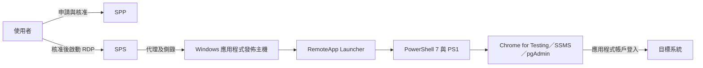
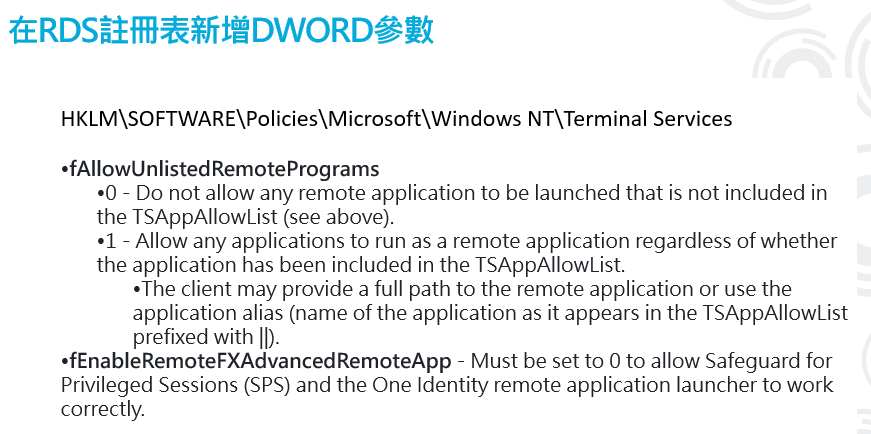
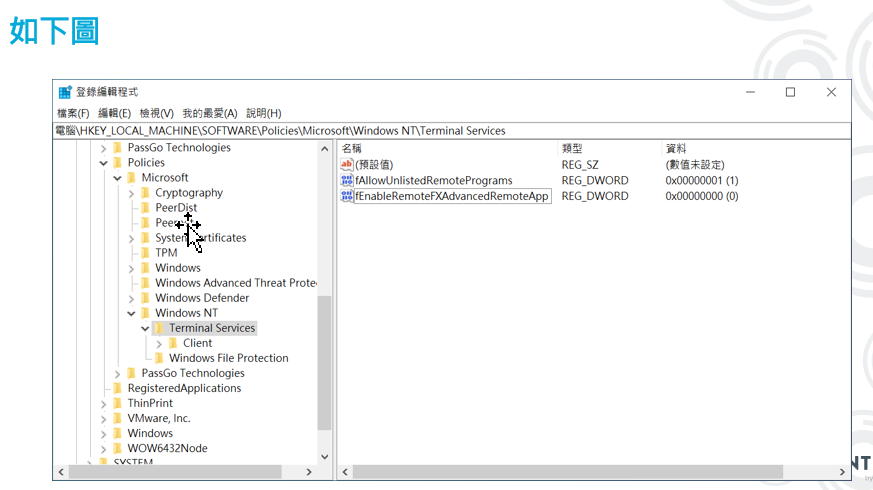
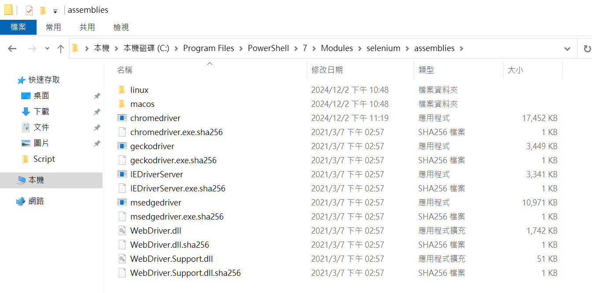
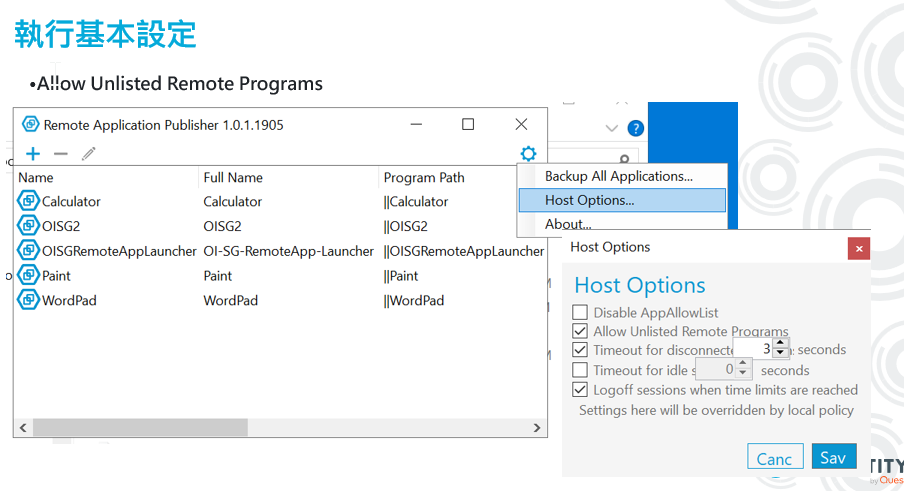
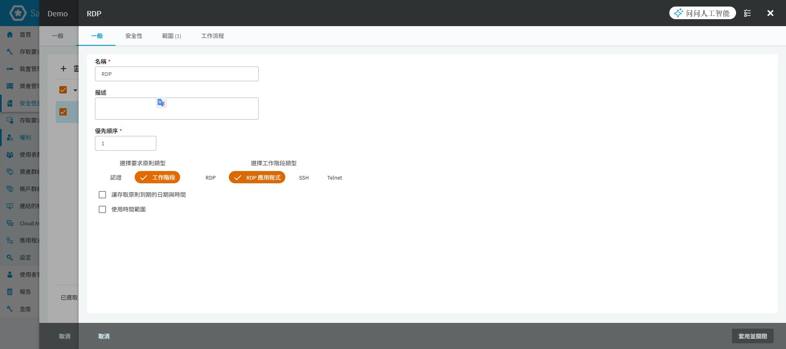
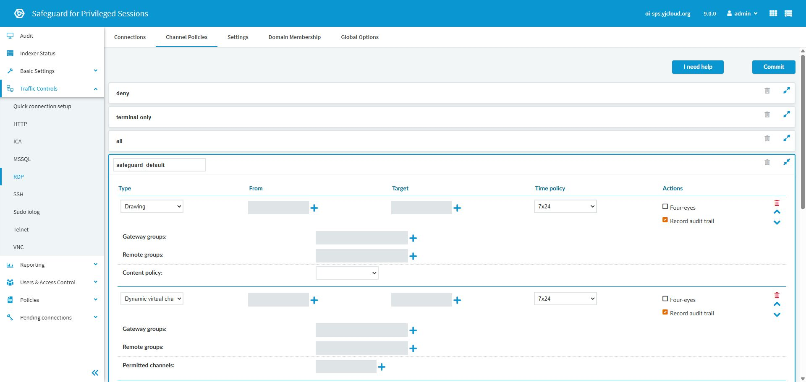
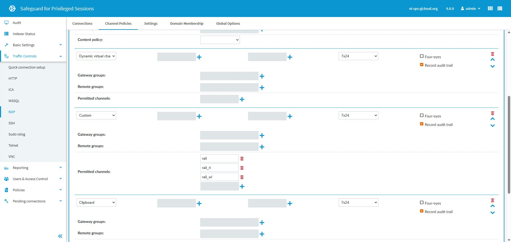
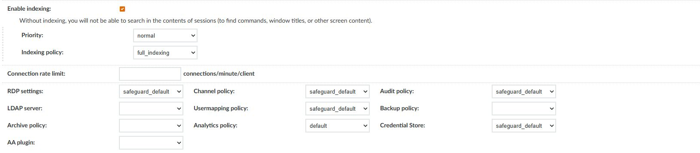
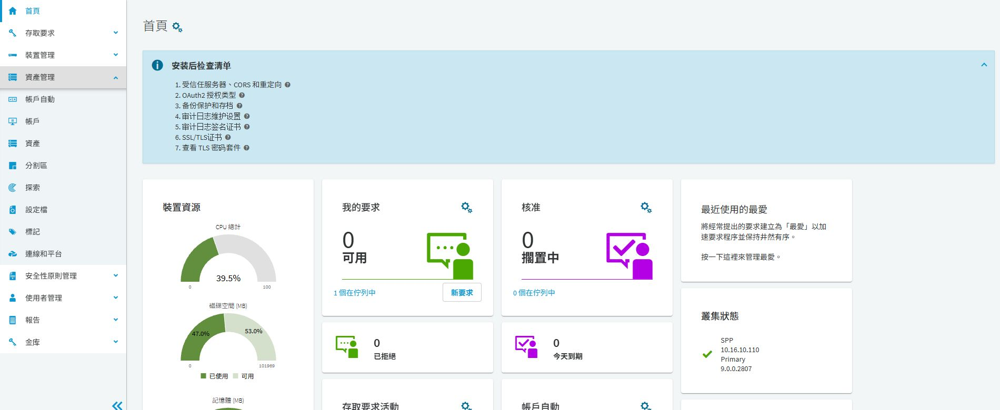

# SPP／SPS 遠端應用程式發佈整合

使用者在 SPP 申請並取得核准後，經 SPS 代理連到 Windows 應用程式發佈主機，由 RemoteApp Launcher 啟動 PowerShell 7 腳本，自動登入目標系統。網頁系統以 Selenium 驅動 **Chrome for Testing（CfT）**，桌面程式（例如 SSMS、pgAdmin）以 UI Automation 操作視窗。

> [!NOTE]
> 本文只寫「照著做」的步驟。套件版本與雜湊、各腳本的 asset 格式與限制、過去的排錯案例，請見 [KB-003：客製化應用程式代登腳本參考](../kb/custom-app-login-selenium.md)。

## 快速導覽

| 步驟 | 做什麼 | 在哪裡做 |
|---|---|---|
| [1](#步驟-1設定發佈主機的-remoteapp-原則) | 設定兩個 RemoteApp 登錄值 | 發佈主機 |
| [2](#步驟-2部署-powershell-7selenium-與-chrome-for-testing) | 部署 PowerShell 7、Selenium 模組、Chrome for Testing 與 ChromeDriver | 發佈主機 |
| [3](#步驟-3放置代登腳本) | 放置代登腳本並設定權限 | 發佈主機 |
| [4](#步驟-4在-publisher-建立發佈項目) | 建立發佈別名與 Launcher 命令列 | 發佈主機（Remote Application Publisher） |
| [5](#步驟-5在-spp-建立資產與存取要求原則) | 建立資產、帳戶與 RDP 應用程式原則 | SPP |
| [6](#步驟-6在-sps-設定通道原則並指派到-connection) | 允許 RemoteApp 通道並指派到 Connection | SPS |
| [7](#步驟-7申請啟動與驗收) | 申請、啟動、逐項驗收 | 使用者電腦與 SPP |

到客戶端部署前先看 [客戶端部署前檢查](#客戶端部署前檢查)；出問題時直接看 [疑難排解](#疑難排解)。

## 架構



- **SPP**：申請、核准、交付帳密。
- **SPS**：代理 RDP 工作階段並側錄。
- **發佈主機**：Launcher 啟動 PS1，由 PS1 操作瀏覽器或桌面程式。

代登失敗不一定是 SPS 的問題，依「RDP 是否建立 → 程式是否啟動 → 目標是否登入」三段判斷。

## 前置條件

- [ ] SPP 與 SPS 已完成整合，SPS 可連到發佈主機，發佈主機可連到目標系統。
- [ ] 已確認 RDS 授權：發佈主機安裝 RD 工作階段主機角色，並備妥 RDS CAL 與授權伺服器。Windows Server 管理用遠端連線不能替代 RDS 發佈授權（[Microsoft RDS CAL 說明](https://learn.microsoft.com/en-us/windows-server/remote/remote-desktop-services/rds-client-access-license)）。
- [ ] 已記錄下表各物件的實際值。

| 物件 | 範例 | 說明 |
|---|---|---|
| 發佈主機 | `<CUSTOMER_RDS_HOST>` | 執行 Launcher、PowerShell、瀏覽器與 PS1 的 Windows 主機 |
| 主機登入帳戶（RemoteApp 執行帳戶） | `<CUSTOMER_REMOTEAPP_USER>` | 登入 Windows 工作階段的帳戶，**不是**目標系統帳戶 |
| 目標系統 | `<CUSTOMER_APP_HOST>` | 由 PS1 的 `-asset` 帶入 |
| 目標帳戶 | `<CUSTOMER_APP_ACCOUNT>` | 由 PS1 的 `-username`／`-password` 帶入，須在 SPP 申請範圍內 |
| 發佈別名 | `\|\|MSSQL` | SPP 原則與 Publisher 必須一致；`\|\|` 是別名語法，不是路徑 |
| 腳本 | `C:\custom\mssql\mssql.ps1` | 位於發佈主機，不是使用者電腦或 SPS |
| SPS Connection／Channel Policy | 各自記錄名稱 | Connection 必須引用允許 RemoteApp 通道的 Channel Policy |

> [!CAUTION]
> 實際帳密不得寫進文件、Git、命令列截圖或日誌。

## 客戶端部署前檢查

改良版腳本只在實驗室驗證過（見 [驗證範圍](#驗證範圍)），帶到客戶端前先核對下列與環境相關的項目。勾不起來的項目，要在客戶的測試環境實測或修改腳本後才能上線。

**授權與主機**

- [ ] 發佈主機已安裝 RD 工作階段主機角色，RDS CAL 與授權伺服器就緒，Windows 已啟用。實驗室主機缺這些仍能啟動 RemoteApp，但不符合正式授權。
- [ ] RemoteApp 執行帳戶是專用帳戶，不與一般使用者或管理員共用。PGADMIN.ps1 每次會清空該帳戶的 pgAdmin 伺服器清單，MSSQL.ps1 的 `-ResetProfile` 會清除該帳戶的 SSMS 設定。

**密碼與命令列**

- [ ] SPP 密碼原則排除空白、`"`，也不以 `-` 開頭；這些字元經 Launcher 傳給 `pwsh -File` 時會被拆錯。
- [ ] 以 SPP **輪替後**產生的複雜密碼實測代登（實驗室只測過短密碼）。腳本本身可輸入任何字元，風險在命令列傳遞。
- [ ] Launcher 命令列只放必要參數，正式環境拿掉 `-DumpTree`。

**MSSQL.ps1（SSMS）**

- [ ] 客戶的 SSMS 是 **20.x 繁體中文版**；英文版或 SSMS 21 須修改腳本的 `$UI` 介面字串並重測。
- [ ] 目標帳戶是 SQL 登入；AD 網域帳戶不能以此腳本登入。
- [ ] 確認 SQL Server 憑證處理方式：發佈主機信任該憑證時不加任何憑證參數；不信任時須同時加 `-TrustServerCertificate -ResetProfile`。

**PGADMIN.ps1（pgAdmin）**

- [ ] 客戶的 pgAdmin 是 **9.19 英文介面**；其他版本或語言先加 `-DumpTree` 跑一次，核對視窗、Servers 節點與 OK 按鈕的辨識結果。
- [ ] PostgreSQL 的 `pg_hba.conf` 已放行 SPP appliance 與發佈主機的 IP。
- [ ] 依客戶要求決定 SSL：PostgreSQL 啟用 SSL 時，SPP 資產勾選 Use SSL，命令列加 `-SSLMode require`。
- [ ] 使用者知道啟動後約 15 秒內不要操作滑鼠鍵盤。

**驗收方式**

先以測試帳戶在客戶測試環境完成 [步驟 7](#步驟-7申請啟動與驗收) 的驗收表，重點是：輪替後的複雜密碼、客戶實際的軟體版本與語言、正式的 RemoteApp 執行帳戶、多人同時使用與側錄回放。全部通過後才開放給一般使用者。

## 步驟 1：設定發佈主機的 RemoteApp 原則

在**發佈主機**的 `HKEY_LOCAL_MACHINE\SOFTWARE\Policies\Microsoft\Windows NT\Terminal Services` 設定兩個 **DWORD（32 位元）** 值（64 位元系統也一樣）：

| 值名稱 | 本案設定 | 用途 |
|---|---|---|
| `fAllowUnlistedRemotePrograms` | `1` | 允許清單外遠端程式。不是所有部署的必要條件，套用前須取得核准 |
| `fEnableRemoteFXAdvancedRemoteApp` | `0` | 停用 RemoteApp 進階圖形，依 [One Identity Launcher 教學](https://github.com/OneIdentity/SafeguardAutomation/blob/master/RDP%20Applications/Tutorial/README.md)；不等於停用 RemoteFX vGPU |

第二個值對應的 GPO 為 **Computer Configuration > Administrative Templates > Windows Components > Remote Desktop Services > Remote Desktop Session Host > Remote Session Environment > Use advanced RemoteFX graphics for RemoteApp** 設為 **Disabled**（[Microsoft 原則說明](https://learn.microsoft.com/en-us/windows/client-management/mdm/policy-csp-admx-terminalserver#ts_server_advanced_remotefx_remoteapp)；Server 版須核對實際 ADMX）。

1. **備份**：匯出該機碼，並記錄兩個值原本的類型、數值或「原本不存在」。
2. **確認管理來源**：主機若由網域 GPO 控管，改修訂該 GPO，不要用本機值對抗 GPO（[群組原則處理順序](https://learn.microsoft.com/en-us/windows-server/identity/ad-ds/manage/group-policy/group-policy-processing)）。
3. **設定**：只建立或修改這兩個值，保留其他設定。
4. **核對**（唯讀，查無值不等於 `0`）：

```powershell
$key = 'HKLM:\SOFTWARE\Policies\Microsoft\Windows NT\Terminal Services'
if (Test-Path -LiteralPath $key) {
    Get-ItemProperty -LiteralPath $key |
        Select-Object fAllowUnlistedRemotePrograms, fEnableRemoteFXAdvancedRemoteApp
} else {
    'Terminal Services policy key does not exist.'
}
```

> [!WARNING]
> 開放清單外程式時，須搭配專用發佈主機、最小登入權限、程式執行限制與目的地存取限制，並驗證使用者無法經由檔案對話框或子程序啟動未核准工具。

**回復**：把既有值還原為原類型與數值；原本不存在的只刪除本次新增的值，不刪整個機碼。直接匯入 `.reg` 不會刪除後來新增的值。



圖 1：登錄位置與兩個 DWORD 的用途說明圖。



圖 2：登錄編輯程式中 `fAllowUnlistedRemotePrograms` 為 `1`、`fEnableRemoteFXAdvancedRemoteApp` 為 `0`。

## 步驟 2：部署 PowerShell 7、Selenium 與 Chrome for Testing

只有網頁代登需要 Selenium 與 Chrome；只做 SSMS 代登時，安裝 PowerShell 7 即可。

### 2.1 標準路徑

| 元件 | 標準位置 | 重點 |
|---|---|---|
| PowerShell 7 x64 | `C:\Program Files\PowerShell\7\pwsh.exe` | Launcher 必須明確呼叫 `pwsh.exe` |
| Selenium 模組 | `C:\Program Files\PowerShell\7\Modules\selenium` | 放在所有帳戶都讀得到的位置，不要裝在管理員自己的使用者模組目錄 |
| ChromeDriver | `C:\Program Files\PowerShell\7\Modules\selenium\assemblies\chromedriver.exe` | 以實際載入模組的 `ModuleBase\assemblies` 為準；**不必**加入 PATH |
| Chrome for Testing | `C:\Automation\chrome\chrome.exe` | 完整解壓縮 CfT 套件，不要放進 `C:\Program Files\Google\Chrome` |

> [!IMPORTANT]
> 自動化瀏覽器一律使用 **Chrome for Testing**，並與 ChromeDriver 使用**同一個發布版本**。CfT 不會自動更新，適合固定版本（[Google CfT 說明](https://developer.chrome.com/docs/automation-and-testing/chrome-for-testing)）；一般使用者的 Chrome 維持原本的更新管理，不要停用全機 Chrome 更新來解決自動化問題。

### 2.2 部署步驟

1. 安裝經核准的 PowerShell 7 x64。保存的歷史版本（PowerShell 7.4.6、Selenium 4.0.0-preview3）見 [已保存元件](../../examples/custom-app-login/README.md)，以 `git lfs pull` 取得；正式部署依支援與安全要求選版。
2. 將 Selenium 模組放到 `C:\Program Files\PowerShell\7\Modules\selenium`。使用 ZIP 時，解開後只能有一層 `selenium`，內含 `Selenium.psd1`、`Selenium.psm1` 與 `assemblies`。
3. 從 [CfT 官方下載頁](https://googlechromelabs.github.io/chrome-for-testing/)下載同一版本的 Windows 版 Chrome 與 ChromeDriver（[版本配對說明](https://developer.chrome.com/docs/chromedriver/downloads/version-selection)）。
   - Chrome 完整解壓縮到 `C:\Automation\chrome`，確認 `chrome.exe` 直接位於該資料夾（不是藏在 `chrome-win64` 子資料夾）。
   - **先備份**原本的 `assemblies\chromedriver.exe`，再替換成新的 driver。只替換 driver，不要覆蓋 `WebDriver.dll` 等相依檔案。
4. 記錄新舊 driver 的版本、來源與 SHA-256。不要用舊的 `.sha256` 附檔驗收新檔案（原因見 KB-003）。
5. 設定權限：程式與模組資料夾由管理者維護，RemoteApp 執行帳戶只給讀取與執行。


圖 3：Selenium 模組放在 `C:\Program Files\PowerShell\7\Modules`。



圖 4：`chromedriver.exe` 放在模組的 `assemblies`。檔案總管隱藏副檔名，顯示為 chromedriver。

> [!WARNING]
> 模組更新、重裝或重新解壓縮，可能覆蓋手動放入的 driver 或改變實際載入目錄。每次都要重新核對 driver 的路徑、版本與 SHA-256。CfT 不會自動更新，仍須安排瀏覽器與 driver **成套**升級、回歸測試與回復版本。

### 2.3 以 RemoteApp 執行帳戶核對

用 **RemoteApp 實際執行帳戶**開新的工作階段，在 PowerShell 7 執行以下唯讀檢查（不會啟動瀏覽器）：

```powershell
whoami
$PSVersionTable | Select-Object PSVersion, PSEdition
Import-Module Selenium -ErrorAction Stop
$cmd = Get-Command Start-SeDriver -ErrorAction Stop
$driverDir = Join-Path $cmd.Module.ModuleBase 'assemblies'
$driverExe = Join-Path $driverDir 'chromedriver.exe'
$cmd.Module | Select-Object Name, Version, ModuleBase
& $driverExe --version
Get-FileHash -LiteralPath $driverExe -Algorithm SHA256
(Get-Item 'C:\Automation\chrome\chrome.exe').VersionInfo | Select-Object ProductVersion
Get-Command Start-SeDriver -Syntax
```

確認：

- [ ] `whoami` 是 RemoteApp 執行帳戶，不是另一個互動測試帳號。
- [ ] PowerShell 為 7.x；`Start-SeDriver` 存在。
- [ ] ChromeDriver 與 Chrome 的完整版本號一致（不只比主版號）。
- [ ] `ModuleBase` 是剛更新 driver 的那一份模組。同時裝有多份模組時，改用核准的 `Selenium.psd1` 完整路徑載入。

> [!NOTE]
> 保存的 Selenium 4.0.0-preview3 模組中，`-BinaryPath` 接受瀏覽器 **EXE**，`-WebDriverPath` 接受 driver **資料夾**；未指定時，模組會讀 `ChromeWebDriver` 環境變數或退回模組 assemblies。所以腳本應明確傳入這兩個路徑，不要依賴 PATH。其他版本的模組請先以 `Get-Command Start-SeDriver -Syntax` 核對參數。`where.exe chromedriver.exe` 找不到結果是正常的。

最小啟動測試（會開啟瀏覽器，請在核准的測試中執行，URL 換成測試目標）：

```powershell
Start-SeDriver -Browser Chrome `
    -BinaryPath 'C:\Automation\chrome\chrome.exe' `
    -WebDriverPath $driverDir `
    -Arguments @('--start-maximized') `
    -StartURL 'https://<CUSTOMER_APP_HOST>:<CUSTOMER_APP_PORT>/'
```

`--ignore-certificate-errors` 會略過憑證錯誤，只限受控測試；正式環境應修正目標系統的憑證鏈與名稱（[Chromium 參數定義](https://chromium.googlesource.com/chromium/src/+/5a60c8bb002e4573dd0809f4a78d56b4c9720add/chrome/common/chrome_switches.cc)、[ChromeOptions 說明](https://developer.chrome.com/docs/chromedriver/capabilities)）。

<details>
<summary>舊腳本仍以名稱尋找 Chrome 時：補上 Machine PATH 的腳本</summary>

標準做法以 `-BinaryPath` 指定瀏覽器，不需要 PATH。只有仍以名稱尋找 Chrome 的舊腳本才需要這段。PATH 要填**資料夾**（`C:\Automation\chrome`），不是 `chrome.exe`。

User PATH 只屬於該帳號，RemoteApp 若以另一個帳號執行就讀不到；Machine PATH 是全機設定。已開啟的程序不會取得新的 PATH，必須登出並重建該帳號的 RDS 工作階段（[環境變數範圍與繼承](https://learn.microsoft.com/powershell/module/microsoft.powershell.core/about/about_environment_variables)）。

存為 `C:\Automation\Set-AutomationPath.ps1`，以系統管理員執行。它保留原 PATH 順序、只補上 Chrome 目錄，並把異動前後的值寫入 CSV：

```powershell
#requires -Version 7.0
#requires -RunAsAdministrator
[CmdletBinding(SupportsShouldProcess, ConfirmImpact='High')]
param()
$ErrorActionPreference = 'Stop'
$dirs = @('C:\Automation\chrome')
$files = @('chrome.exe')
for ($i = 0; $i -lt $dirs.Count; $i++) {
    if (-not (Test-Path (Join-Path $dirs[$i] $files[$i]))) {
        throw "Missing executable in $($dirs[$i])"
    }
}
$before = [Environment]::GetEnvironmentVariable('Path','Machine')
$parts = @($before -split ';' | Where-Object { $_.Trim() })
$normalized = @($parts | ForEach-Object {
    $_.Trim().TrimEnd('\')
})
$add = @($dirs | Where-Object { $_ -notin $normalized })
if ($add.Count -eq 0) { Write-Output 'No change required'; return }
$after = (@($parts) + @($add)) -join ';'
Write-Output "Before: $before"
Write-Output "After:  $after"
if ($PSCmdlet.ShouldProcess('Machine PATH','Append automation folders')) {
    $audit = Join-Path $PSScriptRoot (
        'PathChange-{0}.csv' -f (Get-Date -Format 'yyyyMMdd-HHmmssfff'))
    $record = [pscustomobject]@{
        Time = (Get-Date).ToString('o'); Before = $before
        Proposed = $after; Actual = $before; Status = 'Prepared'
    }
    $record | Export-Csv $audit -NoTypeInformation -Encoding utf8
    [Environment]::SetEnvironmentVariable('Path',$after,'Machine')
    $record.Actual = [Environment]::GetEnvironmentVariable('Path','Machine')
    $record.Status = 'Applied'
    $record | Export-Csv $audit -NoTypeInformation -Encoding utf8
    Write-Output "Audit: $audit"
}
```

先預覽，再確認套用：

```powershell
& 'C:\Automation\Set-AutomationPath.ps1' -WhatIf
& 'C:\Automation\Set-AutomationPath.ps1' -Confirm
```

回復時依 CSV 的 Before 值比對現況，只移除本次新增的項目。

</details>

## 步驟 3：放置代登腳本

1. 每個應用程式一個資料夾：`C:\custom\<應用程式>\<應用程式>.ps1`，例如 `C:\custom\mssql\mssql.ps1`、`C:\custom\sps\sps.ps1`、`C:\custom\pgadmin\pgadmin.ps1`。
2. 腳本以 **UTF-8 with BOM** 儲存，Windows PowerShell 5.1 才能正確讀取中文字串。
3. 設定權限：

| 對象 | RemoteApp 執行帳戶的權限 |
|---|---|
| 腳本（`.ps1`）與所在資料夾 | 只給讀取與執行（RX） |
| 日誌檔或日誌子資料夾 | 寫入 |

> [!CAUTION]
> 腳本每次都會收到目標帳戶的密碼。不能為了寫日誌而讓使用者對腳本資料夾有修改權限，否則腳本可能被改寫而外洩密碼。

4. 先以專用測試帳戶確認模組、網路與目標登入頁，再測完整代登。不要把正式密碼寫進 PS1 或測試紀錄。

建議使用 repo 內的改良版腳本：[MSSQL.ps1](../../examples/custom-app-login/scripts/MSSQL.ps1)（SSMS）、[SPS.ps1](../../examples/custom-app-login/scripts/SPS.ps1)（網頁）與 [PGADMIN.ps1](../../examples/custom-app-login/scripts/PGADMIN.ps1)（pgAdmin 4 桌面版）。其他原始腳本的限制見 KB-003。

## 步驟 4：在 Publisher 建立發佈項目

### 4.1 核對 Host Options

在 **Remote Application Publisher** 右上角齒輪選單開啟 **Host Options**，核對 **Allow Unlisted Remote Programs**，經核准後按 **Save**，再以步驟 1 的查詢確認 `fAllowUnlistedRemotePrograms=1`。

Publisher 1.0.1.1905 的行為（[官方原始碼](https://github.com/OneIdentity/RemoteApplicationPublisher/blob/release-1.0.1.1905/RemoteApplicationPublisher/RemoteAppHostOptions.cs)）：

- 勾選後寫入 DWORD `1`；**取消勾選會刪除該值**，不是寫入 `0`。
- 機碼 `Policies\Microsoft\Windows NT\Terminal Services` 不存在時，Save 直接返回、不會生效。
- **Disable Allow List** 寫的是另一個位置（`TSAppAllowList\fDisabledAllowList`），不要拿來替代上面的選項。
- Save 會一併套用對話框裡的其他選項（例如逾時），儲存前先記錄整個對話框。



圖 5：Publisher 1.0.1.1905 的 Host Options，**Allow Unlisted Remote Programs** 已勾選。Timeout／Logoff 為原案例設定，不是建議值，請勿照抄。

### 4.2 建立發佈項目


圖 6：Publisher 1.0.3.48455 的發佈清單（使用者提供）。ApexOne 的 Program Path 為 `||ApexOne`，Command Line 呼叫 `pwsh.exe`；Fortigate 的命令列被裁切。

每個項目核對 **Name**、**Full Name**、**Program Path** 與 **Command Line**。Name 就是別名，SPP 原則要填 `||<Name>`。

命令列格式固定如下，填在 Publisher 的 Command Line 欄位（不是在 PowerShell 視窗執行）：

```text
--cmd "<pwsh.exe 路徑>" --args "-File <腳本路徑> -username {username} -password {password} -asset {Target.AssetNetworkAddress} [選用參數]"
```

- `--cmd`、`--args` 由 Launcher 解讀；`--args` 引號內的字串交給 `pwsh.exe`。
- `-File` 之後的所有參數都原樣交給腳本；pwsh 本身的參數（例如 `-NoProfile`）要寫在 `-File` **之前**。
- `{username}`、`{password}`、`{Target.AssetNetworkAddress}` 由 SPP 在啟動時帶入。

| 參數 | 用途 | 注意 |
|---|---|---|
| `--cmd` | 要啟動的程式（PowerShell 7） | 路徑存在、執行帳戶可啟動 |
| `--args` | 交給 `--cmd` 的整串參數 | 整串以雙引號包住，內部不再巢狀加引號 |
| `-File` | 要執行的 PS1 | 必須是腳本實際位置；搬移腳本後要同步修改 |
| `-username`／`-password` | 目標帳戶帳密 | 不是發佈主機的登入帳密；含空白、`"` 或以 `-` 開頭的密碼會被拆錯 |
| `-asset` | 目標位址 | 格式依腳本而定，見下方範例與 KB-003 |

> [!IMPORTANT]
> **命令列不要太長。** 本案 MSSQL 命令列約 300 字元時 RemoteApp 無法啟動，縮短到約 165 字元即恢復，203 字元也測試成功。只加入實際需要的選用參數，每加一個就重新測試一次。

#### 範例一：MSSQL（SSMS 20，桌面程式）

```text
--cmd "C:\Program Files\PowerShell\7\pwsh.exe" --args "-File C:\custom\mssql\mssql.ps1 -username {username} -password {password} -asset {Target.AssetNetworkAddress} -TrustServerCertificate -ResetProfile"
```

| 參數 | 說明 |
|---|---|
| `-username` | SQL 登入（例如 `sa`）。腳本固定使用「SQL Server 驗證」，**AD 網域帳戶無法以此方式登入** |
| `-asset` | SSMS「伺服器名稱」：`host`、`host,port` 或 `host\instance`，不加 scheme |
| `-TrustServerCertificate` | 勾選「信任伺服器憑證」。連線仍加密，但不驗證憑證來源；SQL Server 憑證受發佈主機信任時應省略 |
| `-ResetProfile` | 啟動前清除該帳戶 SSMS 19.x／20.x 的 `UserSettings.xml` 與 `SqlStudio.bin`，也會清掉伺服器連線紀錄與偏好設定 |
| `-HostNameInCertificate`（選用） | 憑證名稱與連線位址不同時填入 |
| `-TimeoutSec`（選用） | 等待 SSMS 視窗的秒數，預設 `120` |
| `-LogPath`（選用） | 日誌位置，預設 `C:\custom\MSSQL\MSSQL.log` |

> [!WARNING]
> **`-TrustServerCertificate` 必須搭配 `-ResetProfile`。** SSMS 20.2 讀不到「信任伺服器憑證」的勾選狀態，腳本只能切換、不能指定為勾選；SSMS 又會記住上次的狀態，不重設時可能把已勾選切回未勾選，出現 `SSL Provider` 的「此憑證鏈結是由不受信任的授權單位發出的」。長期應讓發佈主機信任 SQL Server 憑證（匯入憑證或其 CA，或改用企業 CA 簽發），之後兩個參數都可移除。

#### 範例二：SPS 管理網頁（網頁程式）

```text
--cmd "C:\Program Files\PowerShell\7\pwsh.exe" --args "-File C:\custom\sps\sps.ps1 -username {username} -password {password} -asset {Target.AssetNetworkAddress}"
```

| 參數 | 說明 |
|---|---|
| `-username` | SPS 本機帳戶，輸入登入頁的 `local-username` 欄位 |
| `-asset` | SPS 主機名稱或 IP；非 443 埠寫成 `host:port`。腳本會自行補 `https://`，已含 scheme 時不重複補 |
| `-ChromePath`（選用） | Chrome 位置，預設 `C:\Automation\chrome\chrome.exe`；找不到時記錄警告並改由 Selenium 自行尋找 |
| `-VerifyCertificate`（選用） | 預設略過 SPS 自簽憑證；SPS 改用受信任憑證後加上此參數 |
| `-TimeoutSec`（選用） | 等待登入欄位的秒數，預設 `30` |
| `-LogPath`（選用） | 日誌位置，預設 `C:\custom\sps\sps.log` |

#### 範例三：PostgreSQL（pgAdmin 4 桌面版）

```text
--cmd "C:\Program Files\PowerShell\7\pwsh.exe" --args "-File C:\custom\pgadmin\pgadmin.ps1 -username {username} -password {password} -asset {Target.AssetNetworkAddress}"
```

| 參數 | 說明 |
|---|---|
| `-username` | PostgreSQL 資料庫帳戶（例如 `postgres`），不是 pgAdmin 的登入帳戶 |
| `-asset` | PostgreSQL 主機名稱或 IP；非 5432 埠寫成 `host:port` |
| `-Port`／`-Database`／`-SSLMode`（選用） | 預設 `5432`、`postgres`、`prefer`；PostgreSQL 啟用 SSL 後可改 `-SSLMode require` |
| `-KeepServers`（選用） | 保留此帳戶 pgAdmin 原有的伺服器清單（預設每次清空重建，見下方） |
| `-DumpTree`（選用） | 把 UI Automation 樹寫入日誌；首次部署或 pgAdmin 升版後用來調整，平常不加 |
| `-NoMaximize`（選用） | 不自動最大化 pgAdmin 視窗 |
| `-PgAdminPath`（選用） | 預設 `C:\Program Files\pgAdmin 4\runtime\pgAdmin4.exe`；找不到時自動搜尋 |
| `-LogPath`（選用） | 日誌位置，預設 `C:\custom\pgadmin\pgadmin.log` |

流程：以 pgAdmin 內附 Python 執行 `setup.py load-servers`，把資產登錄成伺服器（**不寫入密碼**）→ 啟動 pgAdmin → 雙擊 Servers 展開，pgAdmin 自動跳出 Connect to Server → 確認未勾選 Save Password → 輸入密碼並按 OK → 對話框關閉即判定成功。

> [!WARNING]
> - **伺服器清單每次清空重建**：預設以 `--replace` 登錄，RemoteApp 執行帳戶在 pgAdmin 裡原有的伺服器都會被清除，請使用專用帳戶。
> - **PostgreSQL 的 `pg_hba.conf` 要放行兩個來源**：SPP appliance（Check System 與密碼輪替用）以及發佈主機（pgAdmin 連線用）。少一條，就會出現 `no pg_hba.conf entry`。
> - 執行期間腳本會操作滑鼠與鍵盤，使用者不要動作，約 15 秒內完成。密碼以 Unicode 字元碼送出，不受 CapsLock 與中文輸入法影響，也不經過剪貼簿。

三個範例的差別：

| 項目 | MSSQL | SPS | pgAdmin |
|---|---|---|---|
| 自動化方式 | UI Automation 與 Win32 訊息操作 SSMS 視窗 | Selenium 驅動 Chrome for Testing | UI Automation、滑鼠與 SendInput 操作 Electron 視窗 |
| 需要步驟 2 的 Selenium／CfT | 否 | 是 | 否 |
| `-asset` 格式 | SQL Server 名稱，不加 scheme | 主機位址，腳本補 `https://` | 主機位址，可加 `:port` |
| 日誌 | `C:\custom\MSSQL\MSSQL.log` | `C:\custom\sps\sps.log` | `C:\custom\pgadmin\pgadmin.log` |

> [!NOTE]
> ApexOne 等舊腳本使用 `-asset {asset}`。`{asset}` 與 `{Target.AssetNetworkAddress}` 不能任意互換，須依當版 Launcher／SPP 設定確認實際帶入值；三支改良版腳本都會把收到的資產值寫入日誌，可用來核對。不要把目標資產的 Network Address 設為 None，卻又期待它提供連線位址。

## 步驟 5：在 SPP 建立資產與存取要求原則

### 5.1 資產與帳戶

需要兩種資產：

| 資產 | 用途 |
|---|---|
| Windows Server 資產（發佈主機） | RDP 主機資產，用來連到發佈主機 |
| 目標系統資產與帳戶 | 真正要代登的系統與帳戶，由 `{Target.AssetNetworkAddress}`、`{username}`、`{password}` 帶入腳本 |

8.0 LTS 官方範例的應用程式資產把 Network Address 設為 None；客製化腳本需要目標位址，不能照搬。完成後記錄「RDP 主機資產、主機登入帳戶、目標資產、目標帳戶、asset 來源」五個對應值。操作方式見 [新增資產](../../spp_asset.md) 與 [新增帳戶](spp-account-management.md)。

> [!WARNING]
> 不要把發佈主機的 Administrator 當成目標系統帳戶，也不要為了顯示所有帳戶而放寬申請範圍。

### 5.2 RDP 應用程式原則

到 `安全性原則管理 > 權利 > 存取要求原則` 建立**專用**原則，不要修改共用的一般 RDP 原則。

1. **一般**：選「工作階段」→「RDP 應用程式」，名稱能辨識工具（例如 `ApexOne-RemoteApp`）。
2. **安全性**：依下表填寫。

| 欄位 | 填寫方式 | 本次示範值 |
|---|---|---|
| SPS 連線原則 | 引用步驟 6 設定好的 Connection | `safeguard_rdp` |
| 以資產為基礎的工作階段存取 | 目錄帳戶（按其下方的「瀏覽」） | 目錄帳戶 |
| 目錄帳戶 | 經核准的最小權限帳戶 | AD-DC2025 的 `sg_svc`（網域 `brian.local`） |
| RDP 主機資產 | 發佈主機（按 RDP 主機資產旁的「瀏覽」） | `App`（10.16.10.108） |
| 應用程式顯示名稱 | 給使用者看的名稱 | `ApexOne` |
| 啟動方式 | 使用應用程式別名 | 使用應用程式別名 |
| 應用程式別名 | `\|\|<Publisher 的 Name>`，**必須與步驟 4 一致** | `\|\|ApexOne` |

3. **範圍**：只加入這次需要的資產與帳戶。
4. **使用者**：加入申請人。
5. **工作流程 > 核准者**：指定核准人、人數、期限與通知；核准人不能是申請人。同時核對緊急存取不會跳過一般核准。

> [!IMPORTANT]
> 「目錄帳戶」與「需要主機帳戶」是不同設定。未勾選「需要主機帳戶」時，8.0 LTS 文件說明會在工作階段初始化時要求主機認證，不能把目錄帳戶自動視為 Windows 主機登入帳戶（[官方欄位說明](https://support.oneidentity.com/it-it/technical-documents/one-identity-safeguard/8.0%20lts/administration-guide/101)）。「使用應用程式別名」與「使用應用程式路徑和命令行」二擇一，不要把別名填到檔案路徑欄位。



圖 7：名稱 ApexOne-RemoteApp，選取工作階段／RDP 應用程式。


圖 8：目錄帳戶 sg_svc、RDP 主機資產 App、應用程式顯示名稱 ApexOne。


圖 9：應用程式別名 `||ApexOne`。


圖 10：核准欄位位置（取自一般 RDP 原則，需要 1 人、sgadmin）。

## 步驟 6：在 SPS 設定通道原則並指派到 Connection

1. 到 `Traffic Controls > RDP > Channel Policies`，正式環境建立**專用**原則，不要修改共用原則。
2. 核對以下通道：

| 通道類型 | 設定 |
|---|---|
| Drawing | 勾選 **Record audit trail**（側錄） |
| Dynamic virtual channel | 啟用，不另填設定 |
| Custom | Permitted channels 加入 `rail`、`rail_ri`、`rail_wi` |

3. 到 `Traffic Controls > RDP > Connections`，展開 SPP 原則所用的 Connection，把 **Channel policy** 指向上述原則。**只建立原則但沒有指派，不會改變實際連線行為。**
4. 變更前保存原設定，依核准的變更程序套用。

> [!WARNING]
> 不要把三個 rail 通道填到錯誤的通道類型，也不要為了讓程式啟動而改成全部允許。



圖 11：safeguard_default 原則，Drawing 的 Record audit trail 已勾選。



圖 12：同一原則的 Dynamic virtual channel，以及 Custom 的 `rail`、`rail_ri`、`rail_wi`。下方 Clipboard 是現場既有值，不是必要設定。



圖 13：Connection 的 Channel policy 欄位（局部畫面，未含 Connection 名稱）。

## 步驟 7：申請、啟動與驗收

1. 使用者電腦須先完成 [SCALUS 配置](scalus-install.md)。SCALUS 在使用者電腦，Launcher 在發佈主機，兩者不同。
2. 以專用申請人提出要求，由另一個核准身分核准，要求可用後啟動。
3. 依下表逐項驗收，並保存去識別後的證據（不要截入密碼、Token、完整一次性連線字串與客戶個資）。



圖 14：SPP 首頁的「我的要求」、「新要求」與「核准」入口。

| 驗收項目 | 必須看到的結果 | 保存的證據 |
|---|---|---|
| 申請／核准 | 正確工具與目標；核准前不能啟動 | 不含密碼的申請與核准狀態 |
| Windows 工作階段 | 連到正確發佈主機、正確主機登入身分 | 主機端工作階段紀錄 |
| 啟動程式 | 只開啟核准的程式，不是桌面或命令殼層 | 發佈別名與啟動畫面 |
| 代登 | 正確目標與登入身分，沒有停在登入頁 | 腳本日誌、去識別的登入完成畫面 |
| 側錄 | 可依時間、使用者、目標找到並回放 | SPS 查詢與播放結果 |
| 結束 | 目標登出、SPP 歸還、程序清理符合設計 | 歸還狀態與殘留程序檢查 |
| 多人使用 | 兩個工作階段互不干擾 | 不同身分同時測試的結果 |

最後確認：

- [ ] 步驟 1 的兩個 DWORD 符合核准值，並留有原值紀錄。
- [ ] 步驟 4.1 Host Options 儲存後已重新查值，未混用 Disable Allow List。
- [ ] 步驟 2.3 的檢查以 RemoteApp 執行帳戶完成，Chrome 與 driver 版本一致。
- [ ] 腳本日誌開頭的「腳本位置」與 Publisher 的 `-File` 一致，執行帳號是 RemoteApp 執行帳戶。
- [ ] 特殊字元密碼與 `-asset` 格式已實測。
- [ ] 由 SPP／RemoteApp 入口重測成功；側錄與多人使用已各自驗收。

## 疑難排解

先判斷卡在哪一段，再查對應的列。

| 現象 | 卡在 | 原因與處理 |
|---|---|---|
| RemoteApp 錯誤：「無法打開此程式或檔案。若不是 \|\|X 有問題…」 | 啟動程式 | ① SPP 原則的別名與 Publisher 的 Name 不一致（本案 `\|\|SSMS` 對 `MSSQL`），用下方查詢核對；② Launcher 命令列太長，先縮到只傳帳密與資產再測 |
| Host Options 已勾選但沒生效 | 啟動程式 | 機碼不存在、儲存權限或 GPO 蓋掉；依步驟 4.1 查實際值，不要改勾 Disable Allow List |
| RemoteApp 遭拒或圖形異常 | 啟動程式 | 核對別名、程式權限、步驟 1 的兩個 DWORD 與有效 GPO；不要直接放寬所有程式 |
| 程式閃退且沒有日誌 | 腳本 | 確認 `-File` 路徑正確、Launcher 呼叫的是 `pwsh.exe`、日誌位置可寫入。`#requires` 失敗發生在腳本執行前，不會留下日誌 |
| `cannot find Chrome binary (SessionNotCreated)` | 瀏覽器啟動 | 執行帳戶讀不到 Chrome：以 `-BinaryPath` 指定，或改用 Machine PATH 並重建工作階段；核對檔案權限 |
| `only supports Chrome version ...` | 瀏覽器啟動 | Chrome 與 driver 版本不符：換成同版本 CfT 成套檔案，確認沒有用到 assemblies 內的舊 driver |
| WebDriver.dll 載入失敗 | 瀏覽器啟動 | 用 Windows PowerShell 5.1 執行了；改用 PowerShell 7 |
| 無法辨識 `Start-SeDriver` | 瀏覽器啟動 | 模組沒有載入，或執行帳戶讀不到模組目錄 |
| `Only String attributes are supported`（StartURL） | 瀏覽器啟動 | 單獨測試時 `$asset` 沒有值；先指定完整 URL |
| 改 PATH 後仍失敗 | 瀏覽器啟動 | 工作階段仍沿用舊環境；確認沒有進行中的工作後，重建該帳號的 RDS 工作階段 |
| 瀏覽器開啟但沒登入 | 代登 | 查 URL、等待時間、欄位選取器與目標系統的驗證流程；不要反覆修改 PATH |
| SSMS：`error: 40 - Could not open a connection to SQL Server` | 代登 | 網路層連不到 SQL Server：檢查 `-asset` 格式、TCP/IP 是否啟用、防火牆、SQL Browser |
| SSMS：`SSL Provider` 憑證鏈結不受信任 | 代登 | 加上 `-TrustServerCertificate -ResetProfile`，或讓發佈主機信任 SQL Server 憑證 |
| SSMS：登入失敗（錯誤 18456） | 代登 | 帳號須為 SQL 登入；看 SQL Server ERRORLOG 的 State：5＝登入不存在、8＝密碼錯誤、58＝伺服器只允許 Windows 驗證 |
| SPP Check System：`SSL connection requested. No SSL enabled connection from this host is configured.` | SPP 資產 | 資產勾了 Use SSL，但 PostgreSQL 沒有提供 SSL：取消勾選，或在 PostgreSQL 啟用 `ssl = on` 並加 `hostssl` 規則 |
| PostgreSQL 錯誤 `28000`、訊息為亂碼 | SPP 資產／代登 | 中文環境的 PostgreSQL 以 Big5 回傳訊息，內容是「no pg_hba.conf entry」：在 `pg_hba.conf` 為 SPP 與發佈主機的 IP 各加一條規則後 `SELECT pg_reload_conf();`。想看英文訊息可設 `lc_messages` 為英文 |
| pgAdmin：密碼驗證失敗（亂碼為「嚴重錯誤: 密碼驗證失敗」） | 代登 | 日誌的「SendInput 送出 N 個事件」應為密碼長度 × 2；一致時改查 SPP 保存的密碼（Check Password） |
| pgAdmin：只看到黑色視窗 | 啟動程式 | 黑色視窗是 Launcher 主控台；看日誌停在哪一步。`no pq wrapper available`、找不到主視窗等都已在腳本處理，請確認部署的是最新版 |

**核對發佈主機上的別名與腳本路徑**（唯讀）：

```powershell
$base = 'HKLM:\SOFTWARE\Microsoft\Windows NT\CurrentVersion\Terminal Server\TSAppAllowList\Applications'
Get-ChildItem $base | ForEach-Object {
    $p = Get-ItemProperty $_.PSPath
    $file = if ($p.RequiredCommandLine -match '-File\s+(\S+\.ps1)') { $Matches[1] }
    [pscustomobject]@{
        Alias        = $_.PSChildName
        ScriptPath   = $file
        ScriptExists = if ($file) { Test-Path -LiteralPath $file } else { $false }
        CmdLength    = "$($p.RequiredCommandLine)".Length
    }
} | Format-Table -AutoSize
```

### 排錯用日誌

- 三支改良版腳本會把每個階段寫入日誌，日誌不記錄密碼。
- 不要把 `*> C:\...\debug.log` 加進 Launcher 命令列：`*>` 是 PowerShell 語法，經 `pwsh.exe -File` 傳入時會被當成腳本參數（[pwsh 的 File 參數](https://learn.microsoft.com/powershell/module/microsoft.powershell.core/about/about_pwsh?view=powershell-7.4)）。
- 不要把 `$password`、完整命令列、Token、Cookie 或完整錯誤物件寫入日誌；也不要為排錯開啟會收錄密碼的 Transcript。
- 日誌對外分享前先去識別。

<details>
<summary>瀏覽器啟動診斷腳本（只測 Chrome 能否啟動）</summary>

存為 `C:\Automation\Test-BrowserStart.ps1`，以 RemoteApp 執行帳戶執行。日誌寫在該帳戶的 TEMP，不接收也不記錄密碼。完整代登仍須經 RemoteApp 入口驗收。

```powershell
#requires -Version 7.0
[CmdletBinding()]
param([Parameter(Mandatory)][string]$Asset)
$ErrorActionPreference = 'Stop'
$log = Join-Path ([IO.Path]::GetTempPath()) (
    'BrowserStart-{0}-{1}.log' -f (Get-Date -Format 'yyyyMMdd-HHmmss'),$PID)
function Write-Log([string]$Text) {
    '[{0}] {1}' -f (Get-Date -Format 'yyyy-MM-dd HH:mm:ss'),$Text |
        Out-File -LiteralPath $log -Append -Encoding utf8
}
$stage = 'Validate URL'
try {
    Write-Log 'Script started'
    Write-Log "PowerShell: $($PSVersionTable.PSVersion)"
    $uri = $null
    if (-not [Uri]::TryCreate($Asset,[UriKind]::Absolute,[ref]$uri) -or
        $uri.Scheme -notin @('https','http')) {
        throw 'Invalid URL'
    }
    $stage = 'Import module'
    Import-Module Selenium -RequiredVersion 4.0.0 -ErrorAction Stop
    $stage = 'Validate driver path'
    $driverDirectory = Join-Path (Get-Command Start-SeDriver -ErrorAction Stop).Module.ModuleBase 'assemblies'
    if (-not (Test-Path -LiteralPath (Join-Path $driverDirectory 'chromedriver.exe') -PathType Leaf)) {
        throw 'Missing chromedriver.exe in module assemblies'
    }
    Write-Log "Driver directory: $driverDirectory"
    $stage = 'Start-SeDriver'
    Start-SeDriver -Browser Chrome `
        -BinaryPath 'C:\Automation\chrome\chrome.exe' `
        -WebDriverPath $driverDirectory `
        -Arguments @('--start-maximized') `
        -StartURL $Asset | Out-Null
    Write-Log 'Start-SeDriver completed'
}
catch {
    $reason = 'Unclassified failure'
    if ($_.Exception.ToString() -match 'cannot find Chrome binary') {
        $reason = 'cannot find Chrome binary'
    } elseif ($_.Exception.ToString() -match 'only supports Chrome version') {
        $reason = 'ChromeDriver version mismatch'
    }
    Write-Log "ERROR stage=$stage; reason=$reason"
    throw "Browser startup failed at $stage. Review local log: $log"
}
finally {
    Write-Output "Log: $log"
}
```

```powershell
& 'C:\Automation\Test-BrowserStart.ps1' -Asset 'https://<CUSTOMER_APP_HOST>:<CUSTOMER_APP_PORT>/'
```

</details>

### 回復

先撤回測試權利，再還原原本的 Connection／Channel Policy 對應；不要中止既有的正式工作階段。

## 安全注意事項

- RemoteApp 不等於完整的程式隔離：須檢查開啟檔案、另存新檔與外部工具能否跳出核准程式，並限制發佈主機可執行的程式與可連線的目的地。
- 密碼以命令列參數傳給腳本，同一主機上有權讀取程序資訊的人可能看得到。
- 原始網頁腳本多以 `taskkill /f /im chromedriver.exe` 結束所有人的 driver，並略過 TLS 驗證，不適合直接用在多人共用的主機；改良版 SPS.ps1 只清理自己啟動的 driver。
- 多人共用主機時，只清理自己建立的 driver 與瀏覽器。

## 驗證範圍

| 範圍 | 狀態 |
|---|---|
| 版本 | SPP 9.0.0.2807、SPS 9.0.0 的畫面；引用的 8.0 LTS 官方設定須依現場版本確認，不代表 9.0 全功能相容 |
| 2026-11-19 實測 | MSSQL：經 SPP／RemoteApp 以 `sg_svc` 代登 SSMS 20.2.37.0 成功（SQL 驗證）。SPS：改良版 SPS.ps1 登入成功，CfT 與 ChromeDriver 同為 155.0.8059.79，該次執行帳號為 `Administrator`，若 RemoteApp 實際使用其他帳號須再驗收。pgAdmin：經 SPP／RemoteApp 以 `sg_svc` 代登 pgAdmin 4 9.19，連線 PostgreSQL 18 成功（`postgres` 帳戶，未啟用 SSL） |
| 2026-10-07 案例 | 改用 Machine PATH 後解決 `cannot find Chrome binary`，為使用者回報的單一案例 |
| 發佈主機觀察 | 本案發佈主機未安裝 RD 工作階段主機角色、Windows 尚未啟用，RemoteApp 仍能啟動；這不符合正式授權要求，正式環境須補齊 |
| 圖 1 | 設定說明圖，不是實機結果 |
| 圖 2 | 只呈現登錄值，不代表有效 GPO 或代登成功 |
| 圖 5 | Publisher 1.0.1.1905；未證明已按 Save |
| 圖 6 | 使用者提供的 Publisher 1.0.3.48455 畫面，與圖 5 版本不同；只證明設定方式，不代表每筆都登入成功 |
| 圖 7–9 | 實驗室填寫的未儲存表單；App 資產是否已安裝 ApexOne 發佈項目未確認；sg_svc 為示範值 |
| 圖 10 | 一般 RDP 原則的核准欄位，不是 RemoteApp 原則的完成紀錄 |
| 圖 11–13 | 只證明通道配置，未證明可回放的 RemoteApp 側錄；圖 13 不含 Connection 名稱 |
| 圖 14 | 入口定位圖，不是申請成功的證據 |
| 尚未驗收 | Launcher 與 RDS 發佈精靈的安裝畫面、側錄回放、多人同時使用 |

## 相關文件

- [KB-003：客製化應用程式代登腳本參考](../kb/custom-app-login-selenium.md)
- [SCALUS 配置](scalus-install.md)
- [實機截圖與驗證範圍](environment-evidence.md)
- [權利與存取原則](spp-entitlements.md)
- [申請、核准與歸還](spp-session-workflow.md)
- [SPP 8.0 LTS 官方 Remote Desktop Application 整合](https://support.oneidentity.com/technical-documents/one-identity-safeguard-for-privileged-passwords/8.0%20lts/administration-guide/18)
- [Microsoft：從 Windows PowerShell 5.1 移轉到 PowerShell 7](https://learn.microsoft.com/powershell/scripting/install/migrating-from-windows-powershell-51-to-powershell-7)
- [回專案目錄](../../README.md)
